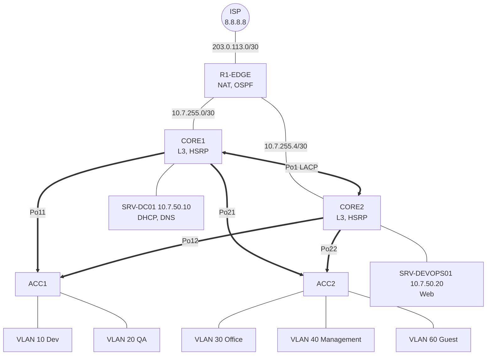

# Đề tài 07: Triển khai hạ tầng mạng doanh nghiệp hỗn hợp Cisco, Windows Server và Linux

Tài liệu này vừa là **hướng dẫn tự làm**, vừa là **khung báo cáo**. Làm lần lượt từ trên xuống, không bỏ bước, vì bước sau dùng kết quả của bước trước.

Mỗi bước có thể gồm các phần sau:

- **Làm:** thao tác hoặc lệnh cần chạy.
- **Giải thích:** vì sao phải làm, dùng khi viết báo cáo và bảo vệ.
- **Kiểm tra:** lệnh và kết quả *mong đợi*. Nếu chưa đúng thì sửa xong mới đi tiếp.
- **📸 Chụp:** ảnh minh chứng, lưu vào `docs/images/` theo đúng tên ghi ở đó.

## Mục lục

- [Phần 0. Phân tích và thiết kế](#phần-0-phân-tích-và-thiết-kế)
- [Phần 1. Chuẩn bị môi trường](#phần-1-chuẩn-bị-môi-trường)
- [Phần 2. Dựng sơ đồ trên Packet Tracer](#phần-2-dựng-sơ-đồ-trên-packet-tracer)
- [Phần 3. Cấu hình Cisco](#phần-3-cấu-hình-cisco)
- [Phần 4. Windows Server](#phần-4-windows-server)
- [Phần 5. Ubuntu Server và DevOps](#phần-5-ubuntu-server-và-devops)
- [Phần 6. Máy trạm gia nhập domain](#phần-6-máy-trạm-gia-nhập-domain)
- [Phần 7. Kết nối Gitea với Active Directory](#phần-7-kết-nối-gitea-với-active-directory)
- [Phần 8. Kiểm thử tổng thể](#phần-8-kiểm-thử-tổng-thể)
- [Phần 9. Hoàn thiện báo cáo và tự push Git](#phần-9-hoàn-thiện-báo-cáo-và-tự-push-git)
- [Phụ lục. Xử lý lỗi thường gặp](#phụ-lục-xử-lý-lỗi-thường-gặp)

---

## Phần 0. Phân tích và thiết kế

### 0.1. Mục đích và tình huống

**Mục đích:** xây dựng hạ tầng đa nền tảng gồm mạng Cisco, Windows Domain và dịch vụ DevOps trên Linux.

**Tình huống:** công ty có 90 nhân viên thuộc các nhóm Dev, QA, HR, IT, cần có Git Server và Docker Registry nội bộ.

| Yêu cầu đề tài | Cách đáp ứng | Làm ở |
|---|---|---|
| VLAN Dev, QA, Office, Management, Server, Guest | VLAN 10, 20, 30, 40, 50, 60 | Phần 3 |
| OSPF | OSPF area 0 giữa R1, CORE1, CORE2 | Bước 3.2, 3.3 |
| EtherChannel | LACP giữa hai core và từ access lên core | Bước 3.3, 3.5 |
| ACL giữa Dev/QA | `ACL_DEV_IN`, `ACL_QA_IN` trên SVI | Bước 3.3 |
| Windows Server 2022/2025: AD DS, DNS, File Server, GPO | Máy ảo DC01 | Phần 4, 6 |
| Ubuntu Server: Gitea/GitLab, Docker, Nginx reverse proxy | Máy ảo DEVOPS01 chạy Gitea, Registry, Nginx | Phần 5 |

> Chọn **Gitea** thay vì GitLab vì Gitea nhẹ, chạy tốt trên VM 4 GB RAM. GitLab cần nhiều RAM hơn hẳn, không phù hợp lab trên một máy.

Các thành phần thêm so với đề bài, ghi rõ trong báo cáo: **HSRP** (dự phòng gateway), **NAT** (ra Internet), **DHCP** (cấp IP cho các VLAN người dùng), router **ISP** giả lập Internet.

### 0.2. Mô hình triển khai: hai môi trường

Phần mạng Cisco được mô phỏng bằng **Cisco Packet Tracer**. Packet Tracer không nối được với máy ảo thật, nên lab chia thành hai môi trường dùng **cùng một bộ địa chỉ IP**:

| Môi trường | Chạy gì | Kiểm chứng được gì |
|---|---|---|
| **Packet Tracer** (file `packet-tracer/DT07.pkt`) | Router, switch Cisco, PC các phòng ban. Hai máy chủ được mô phỏng bằng thiết bị *Server* của Packet Tracer: SRV-DC01 (DHCP, DNS) và SRV-DEVOPS01 (web) | VLAN, OSPF, EtherChannel, HSRP, NAT, DHCP relay, ACL Dev/QA |
| **VMware Workstation** (mạng VMnet8 `10.7.50.0/24`) | Máy ảo thật DC01 (Windows Server), DEVOPS01 (Ubuntu), CLIENT01 (Windows 11) | AD DS, DNS, File Server, GPO, Gitea, Docker Registry, Nginx |

**Giải thích:** trong môi trường thật, DC01 và DEVOPS01 cắm vào VLAN 50 của sơ đồ Cisco. Trong lab, hai máy chủ mô phỏng trong Packet Tracer mang đúng IP của máy thật, nên chính sách ACL kiểm chứng trên Packet Tracer áp dụng y hệt cho máy thật. Đây là **hạn chế cần ghi trong báo cáo**.

### 0.3. Phân bổ nhân sự và VLAN

Giả định phân bổ 90 nhân viên như sau (đề bài không cho số cụ thể, bạn có thể đổi nếu giảng viên yêu cầu):

| Phòng ban | Số NV | VLAN | Tên VLAN | Mạng | Gateway ảo (HSRP) | Cấp IP động | HSRP Active |
|---|---:|---:|---|---|---|---|---|
| Dev | 40 | 10 | DEV | 10.7.10.0/24 | 10.7.10.1 | .21 → .250 | CORE1 |
| QA | 20 | 20 | QA | 10.7.20.0/24 | 10.7.20.1 | .21 → .250 | CORE2 |
| HR | 15 | 30 | OFFICE | 10.7.30.0/24 | 10.7.30.1 | .21 → .250 | CORE1 |
| IT | 15 | 40 | MANAGEMENT | 10.7.40.0/24 | 10.7.40.1 | .21 → .250 | CORE2 |
| Máy chủ | – | 50 | SERVER | 10.7.50.0/24 | 10.7.50.1 | IP tĩnh | CORE1 |
| Khách | – | 60 | GUEST | 10.7.60.0/24 | 10.7.60.1 | .21 → .250 | CORE2 |

Ngoài ra có VLAN 998 (cổng không dùng), 999 (native blackhole), 900 (OSPF giữa hai core).

**Giải thích:** dùng /24 cho mọi VLAN để dễ nhớ (số VLAN trùng octet thứ ba) và còn chỗ mở rộng. Dự phòng HSRP được chia đều: CORE1 chính cho VLAN 10, 30, 50, CORE2 chính cho VLAN 20, 40, 60.

### 0.4. Địa chỉ IP thiết bị

**Trong Packet Tracer:**

| Thiết bị | Giao diện | IP | Ghi chú |
|---|---|---|---|
| ISP | Gi0/0 | 203.0.113.2/30 | Nối R1 |
| ISP | Lo0, Lo1 | 8.8.8.8/32, 1.1.1.1/32 | Giả lập máy chủ Internet |
| R1-EDGE | Gi0/0 | 203.0.113.1/30 | Ra ISP, NAT outside |
| R1-EDGE | Gi0/1 | 10.7.255.1/30 | Nối CORE1 |
| R1-EDGE | Gi0/2 | 10.7.255.5/30 | Nối CORE2 |
| R1-EDGE | Lo0 | 10.7.254.1/32 | Router ID |
| CORE1 | Gi1/0/1 | 10.7.255.2/30 | Nối R1 |
| CORE1 | Vlan900 | 10.7.255.9/30 | OSPF với CORE2 |
| CORE1 | Lo0 | 10.7.254.2/32 | Router ID |
| CORE1 | Vlan10..60 | 10.7.x.2/24 | IP thật của SVI |
| CORE2 | Gi1/0/1 | 10.7.255.6/30 | Nối R1 |
| CORE2 | Vlan900 | 10.7.255.10/30 | OSPF với CORE1 |
| CORE2 | Lo0 | 10.7.254.3/32 | Router ID |
| CORE2 | Vlan10..60 | 10.7.x.3/24 | IP thật của SVI |
| ACC1 | Vlan40 | 10.7.40.11/24 | Quản trị |
| ACC2 | Vlan40 | 10.7.40.12/24 | Quản trị |
| SRV-DC01 | Fa0 | 10.7.50.10/24, GW 10.7.50.1 | DHCP, DNS mô phỏng |
| SRV-DEVOPS01 | Fa0 | 10.7.50.20/24, GW 10.7.50.1 | Web mô phỏng Git |

**Trên VMware (mạng VMnet8):**

| Máy ảo | IP | Gateway | DNS | Vai trò |
|---|---|---|---|---|
| DC01 | 10.7.50.10/24 | 10.7.50.2 | 10.7.50.10 | AD DS, DNS, DHCP, File Server, GPO |
| DEVOPS01 | 10.7.50.20/24 | 10.7.50.2 | 10.7.50.10 | Gitea, Docker Registry, Nginx |
| CLIENT01 | 10.7.50.100/24 | 10.7.50.2 | 10.7.50.10 | Máy trạm join domain |
| Máy thật Windows | 10.7.50.1 | – | – | Adapter VMnet8 của máy bạn |

Trên VMware, gateway là `10.7.50.2` (bộ NAT của VMware) thay cho HSRP `10.7.50.1` trong Packet Tracer, vì `.1` đã được máy thật dùng.

Domain: `dt07.lab`, NetBIOS: `DT07`. Tên dịch vụ: `git.dt07.lab`, `registry.dt07.lab`.

### 0.5. Sơ đồ logic



### 0.6. Bảng nối dây trong Packet Tracer

Đây là bảng quan trọng nhất ở Phần 2. Nối đúng từng dòng, vì cấu hình bám theo đúng số cổng.

| Từ | Cổng | Đến | Cổng | Loại cáp | Vai trò |
|---|---|---|---|---|---|
| ISP | Gi0/0 | R1-EDGE | Gi0/0 | Copper Cross-Over | Internet |
| R1-EDGE | Gi0/1 | CORE1 | Gi1/0/1 | Copper Straight-Through | OSPF |
| R1-EDGE | Gi0/2 | CORE2 | Gi1/0/1 | Copper Straight-Through | OSPF |
| CORE1 | Gi1/0/2 | CORE2 | Gi1/0/2 | Copper Cross-Over | Po1 |
| CORE1 | Gi1/0/3 | CORE2 | Gi1/0/3 | Copper Cross-Over | Po1 |
| CORE1 | Gi1/0/4 | ACC1 | Gi1/0/1 | Copper Cross-Over | Po11 |
| CORE1 | Gi1/0/5 | ACC1 | Gi1/0/2 | Copper Cross-Over | Po11 |
| CORE2 | Gi1/0/4 | ACC1 | Gi1/0/3 | Copper Cross-Over | Po12 |
| CORE2 | Gi1/0/5 | ACC1 | Gi1/0/4 | Copper Cross-Over | Po12 |
| CORE1 | Gi1/0/6 | ACC2 | Gi1/0/1 | Copper Cross-Over | Po21 |
| CORE1 | Gi1/0/7 | ACC2 | Gi1/0/2 | Copper Cross-Over | Po21 |
| CORE2 | Gi1/0/6 | ACC2 | Gi1/0/3 | Copper Cross-Over | Po22 |
| CORE2 | Gi1/0/7 | ACC2 | Gi1/0/4 | Copper Cross-Over | Po22 |
| CORE1 | Gi1/0/10 | SRV-DC01 | Fa0 | Copper Straight-Through | VLAN 50 |
| CORE2 | Gi1/0/10 | SRV-DEVOPS01 | Fa0 | Copper Straight-Through | VLAN 50 |
| ACC1 | Gi1/0/5 | PC-DEV1 | Fa0 | Copper Straight-Through | VLAN 10 |
| ACC1 | Gi1/0/6 | PC-DEV2 | Fa0 | Copper Straight-Through | VLAN 10 |
| ACC1 | Gi1/0/7 | PC-QA1 | Fa0 | Copper Straight-Through | VLAN 20 |
| ACC1 | Gi1/0/8 | PC-QA2 | Fa0 | Copper Straight-Through | VLAN 20 |
| ACC2 | Gi1/0/5 | PC-HR1 | Fa0 | Copper Straight-Through | VLAN 30 |
| ACC2 | Gi1/0/6 | PC-HR2 | Fa0 | Copper Straight-Through | VLAN 30 |
| ACC2 | Gi1/0/7 | PC-IT1 | Fa0 | Copper Straight-Through | VLAN 40 |
| ACC2 | Gi1/0/8 | PC-IT2 | Fa0 | Copper Straight-Through | VLAN 40 |
| ACC2 | Gi1/0/9 | PC-GUEST1 | Fa0 | Copper Straight-Through | VLAN 60 |
| ACC2 | Gi1/0/10 | PC-GUEST2 | Fa0 | Copper Straight-Through | VLAN 60 |

**Quy tắc chọn cáp:** thiết bị khác loại (router với switch, switch với PC) dùng **Straight-Through**. Thiết bị cùng loại (router với router, switch với switch) dùng **Cross-Over**.

### 0.7. Ma trận chính sách truy cập

Hàng là nguồn, cột là đích. Chính sách được thực hiện bằng ACL chiều **in** trên SVI của VLAN nguồn.

| Nguồn \ Đích | Dev | QA | Office | Mgmt | DC01 | DEVOPS01 | Internet |
|---|---|---|---|---|---|---|---|
| **Dev** | ✅ | ❌ | ❌ | ❌ | Chỉ dịch vụ AD, DNS, File | Chỉ 80, 443, 2222 | ✅ |
| **QA** | ❌ | ✅ | ❌ | ❌ | Chỉ dịch vụ AD, DNS, File | Chỉ 80, 443, 2222 | ✅ |
| **Office** | ❌ | ❌ | ✅ | ❌ | Chỉ dịch vụ AD, DNS, File | ❌ | ✅ |
| **Mgmt** | ✅ | ✅ | ✅ | ✅ | ✅ | ✅ | ✅ |
| **Guest** | ❌ | ❌ | ❌ | ❌ | ❌ | ❌ | ✅ |

**Giải thích:** ACL extended đặt gần nguồn để chặn gói tin sớm. Dev và QA vẫn dùng chung Git và Registry, nhưng không kết nối trực tiếp được với nhau.

> 📌 Hai điểm nên nêu khi bảo vệ:
> 1. ACL không có trạng thái (stateless). Vì vậy VLAN Dev phải có dòng `permit tcp ... 10.7.40.0 ... established` thì máy IT mới nhận được phản hồi khi chủ động kết nối vào máy Dev.
> 2. Dòng `permit udp any eq 68 any eq 67` phải có, nếu không gói DHCP Discover (nguồn 0.0.0.0) sẽ bị chặn trước khi được relay đến DC01.

---

## Phần 1. Chuẩn bị môi trường

### Bước 1.0. Kiểm tra máy

1. **Làm:** nhấn `Ctrl + Shift + Esc` mở Task Manager, chọn tab **Performance → CPU**.
2. **Kiểm tra:** dòng **Virtualization** là **Enabled**, hoặc có dòng *Virtualization-based security* / *Hyper-V*. Cả hai trường hợp VMware đều chạy được.
3. **Kiểm tra:** ổ D: trống ít nhất **100 GB** cho 3 máy ảo.

> Packet Tracer không cần ảo hoá. VMware Workstation 17 chạy được cả khi Windows bật Hyper-V, nên **không cần tắt Hyper-V** và Docker Desktop vẫn dùng bình thường.

### Bước 1.1. Phần mềm cần có

| Phần mềm | Yêu cầu |
|---|---|
| Cisco Packet Tracer | Bản 8.2 trở lên. Lần đầu mở phải đăng nhập tài khoản Cisco Networking Academy hoặc Skills for All (miễn phí) |
| VMware Workstation Pro | Bản 17 trở lên (bản miễn phí cho cá nhân) |
| Microsoft Word | Viết báo cáo |
| Git | Đưa bài lên GitHub ở Phần 9 |

### Bước 1.2. File ISO

Lưu trong `D:\Code\Detai07_XDHTM\Lab\ISO`. Thư mục `Lab\` không đưa lên Git (Bước 9.3).

| File | Dùng cho | Nguồn chính thức |
|---|---|---|
| `WindowsServer2022_EVAL_x64_en-us.iso` | DC01 | `microsoft.com/evalcenter` |
| `ubuntu-24.04.5-live-server-amd64.iso` | DEVOPS01 | `releases.ubuntu.com/24.04` |
| `Windows11_Enterprise_EVAL_x64_en-us.iso` | CLIENT01 | `microsoft.com/evalcenter` |

**Kiểm tra:**

```powershell
Get-ChildItem "D:\Code\Detai07_XDHTM\Lab\ISO" | Select-Object Name, @{n="GB"; e={[math]::Round($_.Length/1GB, 2)}}
```

**Mong đợi:** đủ 3 file, dung lượng khoảng 4,7 GB, 3,8 GB và 5 GB.

### Bước 1.3. Cấu hình mạng VMware VMnet8

**Giải thích:** ba máy ảo cần chung mạng `10.7.50.0/24` (trùng VLAN Server) và có Internet để tải Docker, cập nhật. Ta đổi mạng NAT sẵn có VMnet8 sang dải này.

1. **Làm:** mở VMware → **Edit → Virtual Network Editor**.
2. **Làm:** bấm **Change Settings** ở góc dưới, chọn **Yes** khi Windows hỏi quyền Administrator.
3. **Làm:** chọn dòng **VMnet8** (loại NAT), ở phía dưới:
   - **Subnet IP:** `10.7.50.0`
   - **Subnet mask:** `255.255.255.0`
4. **Làm:** bấm **NAT Settings...**, kiểm tra **Gateway IP** là `10.7.50.2`, bấm **OK**.
5. **Làm:** bấm **DHCP Settings...**, đặt:
   - **Starting IP address:** `10.7.50.128`
   - **Ending IP address:** `10.7.50.254`

   Bấm **OK**. Giữ DHCP của VMware để các máy ảo cũ của bạn vẫn có mạng, còn máy ảo của đề tài sẽ đặt IP tĩnh dưới `.128`.
6. **Làm:** bấm **Apply → OK**.

> Các máy ảo khác đang dùng NAT sẽ nhận IP mới trong dải `10.7.50.128–254`. Không ảnh hưởng gì đến dữ liệu của chúng.

**Kiểm tra:**

```powershell
Get-NetIPAddress -InterfaceAlias "VMware Network Adapter VMnet8" -AddressFamily IPv4 | Select-Object IPAddress, PrefixLength
```

**Mong đợi:** `10.7.50.1`, PrefixLength `24`.

### Bước 1.4. Tạo thư mục dự án

```powershell
New-Item -ItemType Directory -Force "D:\Code\Detai07_XDHTM\packet-tracer", "D:\Code\Detai07_XDHTM\configs\cisco", "D:\Code\Detai07_XDHTM\configs\windows", "D:\Code\Detai07_XDHTM\configs\linux", "D:\Code\Detai07_XDHTM\docs\images", "D:\Code\Detai07_XDHTM\Lab\VMs"
```

### Bước 1.5. Danh sách tự kiểm tra cuối Phần 1

- [ ] Mở được Packet Tracer và đã đăng nhập
- [ ] Mở được VMware Workstation 17
- [ ] Đủ 3 file ISO trong `Lab\ISO`
- [ ] Adapter VMnet8 trên máy thật có IP `10.7.50.1`
- [ ] Đã tạo các thư mục ở Bước 1.4

---

## Phần 2. Dựng sơ đồ trên Packet Tracer

### Bước 2.1. Tạo file

1. **Làm:** mở Packet Tracer, **File → New**.
2. **Làm:** **File → Save As**, lưu thành `D:\Code\Detai07_XDHTM\packet-tracer\DT07.pkt`.
3. Trong lúc làm, nhấn `Ctrl + S` thường xuyên.

### Bước 2.2. Kéo thiết bị vào sơ đồ

Thanh thiết bị nằm ở góc dưới bên trái màn hình.

| Nhóm trên thanh thiết bị | Thiết bị | Số lượng | Tên đặt |
|---|---|---:|---|
| Network Devices → Routers | **2911** | 2 | ISP, R1-EDGE |
| Network Devices → Switches | **3650-24PS** | 4 | CORE1, CORE2, ACC1, ACC2 |
| End Devices → End Devices | **Server** | 2 | SRV-DC01, SRV-DEVOPS01 |
| End Devices → End Devices | **PC** | 10 | PC-DEV1, PC-DEV2, PC-QA1, PC-QA2, PC-HR1, PC-HR2, PC-IT1, PC-IT2, PC-GUEST1, PC-GUEST2 |

**Làm:** đổi tên hiển thị: bấm vào thiết bị → tab **Config** → ô **Display Name**. Tên thiết bị trong CLI (hostname) sẽ do lệnh cấu hình đặt ở Phần 3.

**Gợi ý bố cục:** ISP trên cùng, dưới là R1-EDGE, rồi hàng CORE1 và CORE2, rồi hàng ACC1 và ACC2. Máy chủ đặt cạnh hai core, PC đặt dưới hai access.

### Bước 2.3. Lắp nguồn cho switch 3650 (bắt buộc)

**Giải thích:** switch 3650-24PS trong Packet Tracer **không có sẵn bộ nguồn**. Nếu không lắp, switch không bật và mọi cổng đều đỏ.

1. **Làm:** bấm vào **CORE1** → tab **Physical**.
2. **Làm:** trong danh sách **Modules** bên trái, kéo **AC-POWER-SUPPLY** thả vào khe nguồn trống ở mặt sau switch (khung phóng to ở dưới ảnh).
3. **Kiểm tra:** switch tự bật, đèn chuyển xanh.
4. **Làm:** lặp lại cho **CORE2, ACC1, ACC2**.

### Bước 2.4. Nối dây

1. **Làm:** bấm biểu tượng tia sét **Connections** ở thanh thiết bị.
2. **Làm:** chọn đúng loại cáp, bấm vào thiết bị thứ nhất, chọn cổng, rồi bấm vào thiết bị thứ hai, chọn cổng.
3. **Làm:** nối đúng từng dòng của [bảng nối dây](#06-bảng-nối-dây-trong-packet-tracer).

> Không dùng loại cáp **Automatically Choose Connection Type**, vì nó tự chọn cổng trống đầu tiên, sẽ lệch với cấu hình.

**Kiểm tra:** bật **Options → Preferences → Always Show Port Labels in Logical Workspace**, đối chiếu tên cổng trên sơ đồ với bảng.

Ban đầu một số chấm trên dây có màu cam hoặc đỏ. Điều này bình thường vì cổng chưa được cấu hình hoặc STP đang hội tụ.

📸 Chụp: `01-topology.png` (toàn bộ sơ đồ, hiện rõ tên cổng)

---

## Phần 3. Cấu hình Cisco

### Lưu ý trước khi dán lệnh

- **Mở CLI:** bấm vào thiết bị → tab **CLI**. Nếu thấy hỏi `Would you like to enter the initial configuration dialog?`, gõ `no` rồi Enter.
- Thay **`CHANGE_ME_ENABLE`** và **`CHANGE_ME_ADMIN`** bằng mật khẩu của bạn. Dùng cùng một giá trị trên mọi thiết bị để dễ nhớ.
- Dán **từng khối một**, xong khối này xem có báo lỗi `% Invalid input` không rồi mới dán khối sau. Packet Tracer có thể bỏ sót lệnh nếu dán khối quá dài.
- Thứ tự cấu hình: ISP → R1-EDGE → CORE1 → CORE2 → ACC1 → ACC2.
- Nếu lệnh `crypto key generate rsa ...` hỏi `How many bits in the modulus`, gõ `2048`.
- Sau khi cấu hình, bấm **Fast Forward Time** (biểu tượng ⏩ ở góc dưới bên phải) vài lần để STP, OSPF và EtherChannel hội tụ nhanh.

### Bước 3.1. ISP

**Giải thích:** router ISP giả lập Internet. Hai loopback 8.8.8.8 và 1.1.1.1 đóng vai máy chủ ngoài Internet, dùng để thử NAT.

```cisco
! ISP - router gia lap Internet Cisco 2911 (Packet Tracer)
enable
configure terminal
hostname ISP
no ip domain-lookup
!
interface GigabitEthernet0/0
 description TO_R1-EDGE
 ip address 203.0.113.2 255.255.255.252
 no shutdown
exit
! Hai dia chi gia lap may chu tren Internet
interface Loopback0
 ip address 8.8.8.8 255.255.255.255
exit
interface Loopback1
 ip address 1.1.1.1 255.255.255.255
exit
!
end
write memory
```

### Bước 3.2. R1-EDGE

**3.2.1. Thông tin cơ bản.** **Giải thích:** đặt tên, mật khẩu, tắt tra tên miền để gõ sai lệnh không bị treo.

```cisco
! R1-EDGE - router bien Cisco 2911 (Packet Tracer)
! Thay CHANGE_ME_ENABLE va CHANGE_ME_ADMIN truoc khi dan.
enable
configure terminal
!
hostname R1-EDGE
no ip domain-lookup
ip domain-name dt07.lab
service password-encryption
enable secret CHANGE_ME_ENABLE
username netadmin privilege 15 secret CHANGE_ME_ADMIN
banner motd #Thiet bi DT07 - chi danh cho nguoi duoc cap quyen#
!
```

**3.2.2. Quản trị SSH và Loopback.** **Giải thích:** chỉ cho SSH và chỉ từ VLAN 40. Loopback dùng làm Router ID ổn định cho OSPF.

```cisco
! --- Quan tri tu xa: chi SSH, chi tu VLAN 40 ---
crypto key generate rsa general-keys modulus 2048
ip ssh version 2
ip access-list standard ACL_VTY
 permit 10.7.40.0 0.0.0.255
 deny any
exit
line console 0
 logging synchronous
 exec-timeout 15 0
exit
line vty 0 4
 access-class ACL_VTY in
 login local
 transport input ssh
 exec-timeout 15 0
exit
!
interface Loopback0
 ip address 10.7.254.1 255.255.255.255
exit
```

**3.2.3. Các cổng.**

```cisco
! --- Cong ra ISP va hai lien ket xuong core ---
interface GigabitEthernet0/0
 description WAN_ISP
 ip address 203.0.113.1 255.255.255.252
 ip nat outside
 no shutdown
exit
interface GigabitEthernet0/1
 description LINK_CORE1
 ip address 10.7.255.1 255.255.255.252
 ip nat inside
 no shutdown
exit
interface GigabitEthernet0/2
 description LINK_CORE2
 ip address 10.7.255.5 255.255.255.252
 ip nat inside
 no shutdown
exit
```

**3.2.4. NAT và default route.** **Giải thích:** PAT cho cả dải 10.7.0.0/16 đi chung IP 203.0.113.1. Default route chỉ ra ISP.

```cisco
! --- NAT overload va default route ra ISP ---
access-list 1 permit 10.7.0.0 0.0.255.255
ip nat inside source list 1 interface GigabitEthernet0/0 overload
ip route 0.0.0.0 0.0.0.0 203.0.113.2
```

**3.2.5. OSPF.** **Giải thích:** `default-information originate` quảng bá default route xuống các core. `passive-interface default` để chỉ hai cổng xuống core mới gửi hello.

```cisco
! --- OSPF va quang ba default route ---
router ospf 1
 router-id 10.7.254.1
 passive-interface default
 no passive-interface GigabitEthernet0/1
 no passive-interface GigabitEthernet0/2
 network 10.7.254.1 0.0.0.0 area 0
 network 10.7.255.0 0.0.0.3 area 0
 network 10.7.255.4 0.0.0.3 area 0
 default-information originate
exit
!
end
write memory
```

**Kiểm tra:**

```cisco
show ip interface brief
ping 8.8.8.8
```

**Mong đợi:** Gi0/0 `up/up`, ping 8.8.8.8 hiện `!!!!!`. Hai cổng xuống core sẽ chưa lên hẳn và chưa có hàng xóm OSPF, vì core chưa được cấu hình.

### Bước 3.3. CORE1

**3.3.1. Thông tin cơ bản, VLAN, STP.** **Giải thích:** `ip routing` bật định tuyến Layer 3. CORE1 làm STP root cho các VLAN mà nó là HSRP Active, để đường Layer 2 và gateway trùng nhau.

```cisco
! CORE1 - switch Layer 3 Cisco 3650-24PS (Packet Tracer)
! Thay CHANGE_ME_ENABLE va CHANGE_ME_ADMIN truoc khi dan.
enable
configure terminal
!
hostname CORE1
no ip domain-lookup
ip domain-name dt07.lab
service password-encryption
enable secret CHANGE_ME_ENABLE
username netadmin privilege 15 secret CHANGE_ME_ADMIN
banner motd #Thiet bi DT07 - chi danh cho nguoi duoc cap quyen#
!
vtp mode transparent
vlan 10
 name DEV
vlan 20
 name QA
vlan 30
 name OFFICE
vlan 40
 name MANAGEMENT
vlan 50
 name SERVER
vlan 60
 name GUEST
vlan 998
 name UNUSED
vlan 999
 name NATIVE_BLACKHOLE
vlan 900
 name TRANSIT_CORE
exit
ip routing
spanning-tree mode rapid-pvst
spanning-tree vlan 10,30,50 root primary
spanning-tree vlan 20,40,60 root secondary
```

**3.3.2. Quản trị SSH.**

```cisco
! --- Quan tri tu xa: chi SSH, chi tu VLAN 40 ---
crypto key generate rsa general-keys modulus 2048
ip ssh version 2
ip access-list standard ACL_VTY
 permit 10.7.40.0 0.0.0.255
 deny any
exit
line console 0
 logging synchronous
 exec-timeout 15 0
exit
line vty 0 4
 access-class ACL_VTY in
 login local
 transport input ssh
 exec-timeout 15 0
exit
```

**3.3.3. Loopback và liên kết Layer 3 lên R1.** **Giải thích:** `no switchport` đổi cổng thành cổng định tuyến.

```cisco
! --- Loopback va lien ket Layer 3 len R1 ---
interface Loopback0
 ip address 10.7.254.2 255.255.255.255
exit
interface GigabitEthernet1/0/1
 description UPLINK_R1-EDGE_G0/1
 no switchport
 ip address 10.7.255.2 255.255.255.252
 no shutdown
exit
```

**3.3.4. EtherChannel giữa hai core.** **Giải thích:** `channel-group 1 mode active` là LACP chủ động. Native VLAN 999 không có người dùng để phòng tấn công VLAN hopping.

```cisco
! --- EtherChannel LACP giua hai core ---
interface range GigabitEthernet1/0/2 - 3
 description PEER_CORE2
 switchport mode trunk
 switchport trunk native vlan 999
 switchport trunk allowed vlan 10,20,30,40,50,60,900
 channel-group 1 mode active
 no shutdown
exit
interface Port-channel1
 description PEER_CORE2
 switchport mode trunk
 switchport trunk native vlan 999
 switchport trunk allowed vlan 10,20,30,40,50,60,900
exit
```

**3.3.5. EtherChannel xuống access.**

```cisco
! --- EtherChannel LACP xuong access ---
interface range GigabitEthernet1/0/4 - 5
 description DOWNLINK_ACC1
 switchport mode trunk
 switchport trunk native vlan 999
 switchport trunk allowed vlan 10,20,30,40,60
 channel-group 11 mode active
 no shutdown
exit
interface Port-channel11
 description DOWNLINK_ACC1
 switchport mode trunk
 switchport trunk native vlan 999
 switchport trunk allowed vlan 10,20,30,40,60
exit
interface range GigabitEthernet1/0/6 - 7
 description DOWNLINK_ACC2
 switchport mode trunk
 switchport trunk native vlan 999
 switchport trunk allowed vlan 10,20,30,40,60
 channel-group 21 mode active
 no shutdown
exit
interface Port-channel21
 description DOWNLINK_ACC2
 switchport mode trunk
 switchport trunk native vlan 999
 switchport trunk allowed vlan 10,20,30,40,60
exit
```

**3.3.6. Cổng máy chủ và tắt cổng không dùng.**

```cisco
! --- Cong may chu va tat cong khong dung ---
interface GigabitEthernet1/0/10
 description SRV-DC01
 switchport mode access
 switchport access vlan 50
 spanning-tree portfast
 spanning-tree bpduguard enable
 no shutdown
exit
interface range GigabitEthernet1/0/8 - 9
 description KHONG_SU_DUNG
 switchport mode access
 switchport access vlan 998
 shutdown
exit
interface range GigabitEthernet1/0/11 - 24
 description KHONG_SU_DUNG
 switchport mode access
 switchport access vlan 998
 shutdown
exit
interface range GigabitEthernet1/1/1 - 4
 description KHONG_SU_DUNG
 switchport mode access
 switchport access vlan 998
 shutdown
exit
```

**3.3.7. ACL phân tách VLAN.** Đây là phần trọng tâm của yêu cầu "ACL giữa Dev/QA". Thứ tự dòng trong ACL có ý nghĩa: thiết bị dừng ở dòng khớp đầu tiên. Cuối mỗi ACL có một dòng `deny any` ngầm định.

```cisco
! --- ACL phan tach VLAN (ap dung chieu in tren SVI) ---
ip access-list extended ACL_DEV_IN
 remark Yeu cau de tai chan Dev va QA
 permit udp any eq 68 any eq 67
 permit ip 10.7.10.0 0.0.0.255 10.7.10.0 0.0.0.255
 deny ip 10.7.10.0 0.0.0.255 10.7.20.0 0.0.0.255
 remark Dich vu AD DNS File tren DC01
 permit udp 10.7.10.0 0.0.0.255 host 10.7.50.10 eq 53
 permit tcp 10.7.10.0 0.0.0.255 host 10.7.50.10 eq 53
 permit udp 10.7.10.0 0.0.0.255 host 10.7.50.10 eq 88
 permit tcp 10.7.10.0 0.0.0.255 host 10.7.50.10 eq 88
 permit udp 10.7.10.0 0.0.0.255 host 10.7.50.10 eq 123
 permit tcp 10.7.10.0 0.0.0.255 host 10.7.50.10 eq 135
 permit udp 10.7.10.0 0.0.0.255 host 10.7.50.10 eq 389
 permit tcp 10.7.10.0 0.0.0.255 host 10.7.50.10 eq 389
 permit tcp 10.7.10.0 0.0.0.255 host 10.7.50.10 eq 445
 permit udp 10.7.10.0 0.0.0.255 host 10.7.50.10 eq 464
 permit tcp 10.7.10.0 0.0.0.255 host 10.7.50.10 eq 464
 permit tcp 10.7.10.0 0.0.0.255 host 10.7.50.10 eq 636
 permit tcp 10.7.10.0 0.0.0.255 host 10.7.50.10 eq 3268
 permit tcp 10.7.10.0 0.0.0.255 host 10.7.50.10 eq 3269
 permit tcp 10.7.10.0 0.0.0.255 host 10.7.50.10 range 49152 65535
 permit icmp 10.7.10.0 0.0.0.255 host 10.7.50.10 echo
 remark Git Registry qua Nginx va Git SSH tren DEVOPS01
 permit tcp 10.7.10.0 0.0.0.255 host 10.7.50.20 eq 80
 permit tcp 10.7.10.0 0.0.0.255 host 10.7.50.20 eq 443
 permit tcp 10.7.10.0 0.0.0.255 host 10.7.50.20 eq 2222
 permit icmp 10.7.10.0 0.0.0.255 host 10.7.50.20 echo
 remark Cho phep tra loi cho may quan tri VLAN 40
 permit tcp 10.7.10.0 0.0.0.255 10.7.40.0 0.0.0.255 established
 permit icmp 10.7.10.0 0.0.0.255 10.7.40.0 0.0.0.255 echo-reply
 remark Chan moi dai noi bo con lai roi cho ra Internet
 deny ip 10.7.10.0 0.0.0.255 10.0.0.0 0.255.255.255
 deny ip 10.7.10.0 0.0.0.255 172.16.0.0 0.15.255.255
 deny ip 10.7.10.0 0.0.0.255 192.168.0.0 0.0.255.255
 permit ip 10.7.10.0 0.0.0.255 any
exit
!
ip access-list extended ACL_QA_IN
 remark Yeu cau de tai chan QA va Dev
 permit udp any eq 68 any eq 67
 permit ip 10.7.20.0 0.0.0.255 10.7.20.0 0.0.0.255
 deny ip 10.7.20.0 0.0.0.255 10.7.10.0 0.0.0.255
 remark Dich vu AD DNS File tren DC01
 permit udp 10.7.20.0 0.0.0.255 host 10.7.50.10 eq 53
 permit tcp 10.7.20.0 0.0.0.255 host 10.7.50.10 eq 53
 permit udp 10.7.20.0 0.0.0.255 host 10.7.50.10 eq 88
 permit tcp 10.7.20.0 0.0.0.255 host 10.7.50.10 eq 88
 permit udp 10.7.20.0 0.0.0.255 host 10.7.50.10 eq 123
 permit tcp 10.7.20.0 0.0.0.255 host 10.7.50.10 eq 135
 permit udp 10.7.20.0 0.0.0.255 host 10.7.50.10 eq 389
 permit tcp 10.7.20.0 0.0.0.255 host 10.7.50.10 eq 389
 permit tcp 10.7.20.0 0.0.0.255 host 10.7.50.10 eq 445
 permit udp 10.7.20.0 0.0.0.255 host 10.7.50.10 eq 464
 permit tcp 10.7.20.0 0.0.0.255 host 10.7.50.10 eq 464
 permit tcp 10.7.20.0 0.0.0.255 host 10.7.50.10 eq 636
 permit tcp 10.7.20.0 0.0.0.255 host 10.7.50.10 eq 3268
 permit tcp 10.7.20.0 0.0.0.255 host 10.7.50.10 eq 3269
 permit tcp 10.7.20.0 0.0.0.255 host 10.7.50.10 range 49152 65535
 permit icmp 10.7.20.0 0.0.0.255 host 10.7.50.10 echo
 remark Git Registry qua Nginx va Git SSH tren DEVOPS01
 permit tcp 10.7.20.0 0.0.0.255 host 10.7.50.20 eq 80
 permit tcp 10.7.20.0 0.0.0.255 host 10.7.50.20 eq 443
 permit tcp 10.7.20.0 0.0.0.255 host 10.7.50.20 eq 2222
 permit icmp 10.7.20.0 0.0.0.255 host 10.7.50.20 echo
 remark Cho phep tra loi cho may quan tri VLAN 40
 permit tcp 10.7.20.0 0.0.0.255 10.7.40.0 0.0.0.255 established
 permit icmp 10.7.20.0 0.0.0.255 10.7.40.0 0.0.0.255 echo-reply
 remark Chan moi dai noi bo con lai roi cho ra Internet
 deny ip 10.7.20.0 0.0.0.255 10.0.0.0 0.255.255.255
 deny ip 10.7.20.0 0.0.0.255 172.16.0.0 0.15.255.255
 deny ip 10.7.20.0 0.0.0.255 192.168.0.0 0.0.255.255
 permit ip 10.7.20.0 0.0.0.255 any
exit
!
ip access-list extended ACL_OFFICE_IN
 remark Office chi dung AD va File
 permit udp any eq 68 any eq 67
 permit ip 10.7.30.0 0.0.0.255 10.7.30.0 0.0.0.255
 remark Dich vu AD DNS File tren DC01
 permit udp 10.7.30.0 0.0.0.255 host 10.7.50.10 eq 53
 permit tcp 10.7.30.0 0.0.0.255 host 10.7.50.10 eq 53
 permit udp 10.7.30.0 0.0.0.255 host 10.7.50.10 eq 88
 permit tcp 10.7.30.0 0.0.0.255 host 10.7.50.10 eq 88
 permit udp 10.7.30.0 0.0.0.255 host 10.7.50.10 eq 123
 permit tcp 10.7.30.0 0.0.0.255 host 10.7.50.10 eq 135
 permit udp 10.7.30.0 0.0.0.255 host 10.7.50.10 eq 389
 permit tcp 10.7.30.0 0.0.0.255 host 10.7.50.10 eq 389
 permit tcp 10.7.30.0 0.0.0.255 host 10.7.50.10 eq 445
 permit udp 10.7.30.0 0.0.0.255 host 10.7.50.10 eq 464
 permit tcp 10.7.30.0 0.0.0.255 host 10.7.50.10 eq 464
 permit tcp 10.7.30.0 0.0.0.255 host 10.7.50.10 eq 636
 permit tcp 10.7.30.0 0.0.0.255 host 10.7.50.10 eq 3268
 permit tcp 10.7.30.0 0.0.0.255 host 10.7.50.10 eq 3269
 permit tcp 10.7.30.0 0.0.0.255 host 10.7.50.10 range 49152 65535
 permit icmp 10.7.30.0 0.0.0.255 host 10.7.50.10 echo
 remark Cho phep tra loi cho may quan tri VLAN 40
 permit tcp 10.7.30.0 0.0.0.255 10.7.40.0 0.0.0.255 established
 permit icmp 10.7.30.0 0.0.0.255 10.7.40.0 0.0.0.255 echo-reply
 remark Chan moi dai noi bo con lai roi cho ra Internet
 deny ip 10.7.30.0 0.0.0.255 10.0.0.0 0.255.255.255
 deny ip 10.7.30.0 0.0.0.255 172.16.0.0 0.15.255.255
 deny ip 10.7.30.0 0.0.0.255 192.168.0.0 0.0.255.255
 permit ip 10.7.30.0 0.0.0.255 any
exit
!
ip access-list extended ACL_GUEST_IN
 remark Guest chi ra Internet
 permit udp any eq 68 any eq 67
 permit ip 10.7.60.0 0.0.0.255 10.7.60.0 0.0.0.255
 deny ip 10.7.60.0 0.0.0.255 10.0.0.0 0.255.255.255
 deny ip 10.7.60.0 0.0.0.255 172.16.0.0 0.15.255.255
 deny ip 10.7.60.0 0.0.0.255 192.168.0.0 0.0.255.255
 permit ip 10.7.60.0 0.0.0.255 any
exit
```

**3.3.8. Gateway HSRP cho các VLAN.** **Giải thích:** client dùng IP ảo `.1`, nên một core hỏng thì core còn lại tiếp quản. `ip helper-address` chuyển yêu cầu DHCP đến SRV-DC01. `ip access-group ... in` gắn ACL vào SVI.

```cisco
! --- Gateway HSRP cho cac VLAN ---
interface Vlan10
 description GW_DEV
 ip address 10.7.10.2 255.255.255.0
 standby version 2
 standby 10 ip 10.7.10.1
 standby 10 priority 110
 standby 10 preempt
 ip helper-address 10.7.50.10
 ip access-group ACL_DEV_IN in
 no shutdown
exit
interface Vlan20
 description GW_QA
 ip address 10.7.20.2 255.255.255.0
 standby version 2
 standby 20 ip 10.7.20.1
 standby 20 priority 100
 standby 20 preempt
 ip helper-address 10.7.50.10
 ip access-group ACL_QA_IN in
 no shutdown
exit
interface Vlan30
 description GW_OFFICE
 ip address 10.7.30.2 255.255.255.0
 standby version 2
 standby 30 ip 10.7.30.1
 standby 30 priority 110
 standby 30 preempt
 ip helper-address 10.7.50.10
 ip access-group ACL_OFFICE_IN in
 no shutdown
exit
interface Vlan40
 description GW_MANAGEMENT
 ip address 10.7.40.2 255.255.255.0
 standby version 2
 standby 40 ip 10.7.40.1
 standby 40 priority 100
 standby 40 preempt
 ip helper-address 10.7.50.10
 no shutdown
exit
interface Vlan50
 description GW_SERVER
 ip address 10.7.50.2 255.255.255.0
 standby version 2
 standby 50 ip 10.7.50.1
 standby 50 priority 110
 standby 50 preempt
 no shutdown
exit
interface Vlan60
 description GW_GUEST
 ip address 10.7.60.2 255.255.255.0
 standby version 2
 standby 60 ip 10.7.60.1
 standby 60 priority 100
 standby 60 preempt
 ip helper-address 10.7.50.10
 ip access-group ACL_GUEST_IN in
 no shutdown
exit
```

**3.3.9. SVI trung chuyển.** **Giải thích:** hai core cần một đường OSPF trực tiếp. VLAN 900 chỉ được phép đi trên Po1.

```cisco
! --- SVI trung chuyen de hai core chay OSPF voi nhau ---
interface Vlan900
 description OSPF_TRANSIT_CORE
 ip address 10.7.255.9 255.255.255.252
 no shutdown
exit
```

**3.3.10. OSPF và lưu cấu hình.**

```cisco
! --- OSPF ---
router ospf 1
 router-id 10.7.254.2
 passive-interface default
 no passive-interface GigabitEthernet1/0/1
 no passive-interface Vlan900
 network 10.7.0.0 0.0.255.255 area 0
exit
!
end
write memory
```

### Bước 3.4. CORE2

CORE2 có cấu trúc giống CORE1, chỉ khác các điểm sau. Nên đọc để hiểu trước khi dán:

| Mục | CORE1 | CORE2 |
|---|---|---|
| IP SVI | 10.7.x.**2** | 10.7.x.**3** |
| HSRP priority 110 và STP root | VLAN 10, 30, 50 | VLAN 20, 40, 60 |
| Gi1/0/1 | 10.7.255.2 | 10.7.255.6 |
| Vlan900 | 10.7.255.9 | 10.7.255.10 |
| Port-channel xuống ACC1 / ACC2 | Po11 / Po21 | Po12 / Po22 |
| Gi1/0/10 | SRV-DC01 | SRV-DEVOPS01 |

**Làm:** dán từng đoạn, mỗi đoạn bắt đầu bằng dòng `! ---`.

```cisco
! CORE2 - switch Layer 3 Cisco 3650-24PS (Packet Tracer)
! Thay CHANGE_ME_ENABLE va CHANGE_ME_ADMIN truoc khi dan.
enable
configure terminal
!
hostname CORE2
no ip domain-lookup
ip domain-name dt07.lab
service password-encryption
enable secret CHANGE_ME_ENABLE
username netadmin privilege 15 secret CHANGE_ME_ADMIN
banner motd #Thiet bi DT07 - chi danh cho nguoi duoc cap quyen#
!
vtp mode transparent
vlan 10
 name DEV
vlan 20
 name QA
vlan 30
 name OFFICE
vlan 40
 name MANAGEMENT
vlan 50
 name SERVER
vlan 60
 name GUEST
vlan 998
 name UNUSED
vlan 999
 name NATIVE_BLACKHOLE
vlan 900
 name TRANSIT_CORE
exit
ip routing
spanning-tree mode rapid-pvst
spanning-tree vlan 20,40,60 root primary
spanning-tree vlan 10,30,50 root secondary
!
! --- Quan tri tu xa: chi SSH, chi tu VLAN 40 ---
crypto key generate rsa general-keys modulus 2048
ip ssh version 2
ip access-list standard ACL_VTY
 permit 10.7.40.0 0.0.0.255
 deny any
exit
line console 0
 logging synchronous
 exec-timeout 15 0
exit
line vty 0 4
 access-class ACL_VTY in
 login local
 transport input ssh
 exec-timeout 15 0
exit
!
! --- Loopback va lien ket Layer 3 len R1 ---
interface Loopback0
 ip address 10.7.254.3 255.255.255.255
exit
interface GigabitEthernet1/0/1
 description UPLINK_R1-EDGE_G0/2
 no switchport
 ip address 10.7.255.6 255.255.255.252
 no shutdown
exit
!
! --- EtherChannel LACP giua hai core ---
interface range GigabitEthernet1/0/2 - 3
 description PEER_CORE1
 switchport mode trunk
 switchport trunk native vlan 999
 switchport trunk allowed vlan 10,20,30,40,50,60,900
 channel-group 1 mode active
 no shutdown
exit
interface Port-channel1
 description PEER_CORE1
 switchport mode trunk
 switchport trunk native vlan 999
 switchport trunk allowed vlan 10,20,30,40,50,60,900
exit
!
! --- EtherChannel LACP xuong access ---
interface range GigabitEthernet1/0/4 - 5
 description DOWNLINK_ACC1
 switchport mode trunk
 switchport trunk native vlan 999
 switchport trunk allowed vlan 10,20,30,40,60
 channel-group 12 mode active
 no shutdown
exit
interface Port-channel12
 description DOWNLINK_ACC1
 switchport mode trunk
 switchport trunk native vlan 999
 switchport trunk allowed vlan 10,20,30,40,60
exit
interface range GigabitEthernet1/0/6 - 7
 description DOWNLINK_ACC2
 switchport mode trunk
 switchport trunk native vlan 999
 switchport trunk allowed vlan 10,20,30,40,60
 channel-group 22 mode active
 no shutdown
exit
interface Port-channel22
 description DOWNLINK_ACC2
 switchport mode trunk
 switchport trunk native vlan 999
 switchport trunk allowed vlan 10,20,30,40,60
exit
!
! --- Cong may chu va tat cong khong dung ---
interface GigabitEthernet1/0/10
 description SRV-DEVOPS01
 switchport mode access
 switchport access vlan 50
 spanning-tree portfast
 spanning-tree bpduguard enable
 no shutdown
exit
interface range GigabitEthernet1/0/8 - 9
 description KHONG_SU_DUNG
 switchport mode access
 switchport access vlan 998
 shutdown
exit
interface range GigabitEthernet1/0/11 - 24
 description KHONG_SU_DUNG
 switchport mode access
 switchport access vlan 998
 shutdown
exit
interface range GigabitEthernet1/1/1 - 4
 description KHONG_SU_DUNG
 switchport mode access
 switchport access vlan 998
 shutdown
exit
!
! --- ACL phan tach VLAN (ap dung chieu in tren SVI) ---
ip access-list extended ACL_DEV_IN
 remark Yeu cau de tai chan Dev va QA
 permit udp any eq 68 any eq 67
 permit ip 10.7.10.0 0.0.0.255 10.7.10.0 0.0.0.255
 deny ip 10.7.10.0 0.0.0.255 10.7.20.0 0.0.0.255
 remark Dich vu AD DNS File tren DC01
 permit udp 10.7.10.0 0.0.0.255 host 10.7.50.10 eq 53
 permit tcp 10.7.10.0 0.0.0.255 host 10.7.50.10 eq 53
 permit udp 10.7.10.0 0.0.0.255 host 10.7.50.10 eq 88
 permit tcp 10.7.10.0 0.0.0.255 host 10.7.50.10 eq 88
 permit udp 10.7.10.0 0.0.0.255 host 10.7.50.10 eq 123
 permit tcp 10.7.10.0 0.0.0.255 host 10.7.50.10 eq 135
 permit udp 10.7.10.0 0.0.0.255 host 10.7.50.10 eq 389
 permit tcp 10.7.10.0 0.0.0.255 host 10.7.50.10 eq 389
 permit tcp 10.7.10.0 0.0.0.255 host 10.7.50.10 eq 445
 permit udp 10.7.10.0 0.0.0.255 host 10.7.50.10 eq 464
 permit tcp 10.7.10.0 0.0.0.255 host 10.7.50.10 eq 464
 permit tcp 10.7.10.0 0.0.0.255 host 10.7.50.10 eq 636
 permit tcp 10.7.10.0 0.0.0.255 host 10.7.50.10 eq 3268
 permit tcp 10.7.10.0 0.0.0.255 host 10.7.50.10 eq 3269
 permit tcp 10.7.10.0 0.0.0.255 host 10.7.50.10 range 49152 65535
 permit icmp 10.7.10.0 0.0.0.255 host 10.7.50.10 echo
 remark Git Registry qua Nginx va Git SSH tren DEVOPS01
 permit tcp 10.7.10.0 0.0.0.255 host 10.7.50.20 eq 80
 permit tcp 10.7.10.0 0.0.0.255 host 10.7.50.20 eq 443
 permit tcp 10.7.10.0 0.0.0.255 host 10.7.50.20 eq 2222
 permit icmp 10.7.10.0 0.0.0.255 host 10.7.50.20 echo
 remark Cho phep tra loi cho may quan tri VLAN 40
 permit tcp 10.7.10.0 0.0.0.255 10.7.40.0 0.0.0.255 established
 permit icmp 10.7.10.0 0.0.0.255 10.7.40.0 0.0.0.255 echo-reply
 remark Chan moi dai noi bo con lai roi cho ra Internet
 deny ip 10.7.10.0 0.0.0.255 10.0.0.0 0.255.255.255
 deny ip 10.7.10.0 0.0.0.255 172.16.0.0 0.15.255.255
 deny ip 10.7.10.0 0.0.0.255 192.168.0.0 0.0.255.255
 permit ip 10.7.10.0 0.0.0.255 any
exit
!
ip access-list extended ACL_QA_IN
 remark Yeu cau de tai chan QA va Dev
 permit udp any eq 68 any eq 67
 permit ip 10.7.20.0 0.0.0.255 10.7.20.0 0.0.0.255
 deny ip 10.7.20.0 0.0.0.255 10.7.10.0 0.0.0.255
 remark Dich vu AD DNS File tren DC01
 permit udp 10.7.20.0 0.0.0.255 host 10.7.50.10 eq 53
 permit tcp 10.7.20.0 0.0.0.255 host 10.7.50.10 eq 53
 permit udp 10.7.20.0 0.0.0.255 host 10.7.50.10 eq 88
 permit tcp 10.7.20.0 0.0.0.255 host 10.7.50.10 eq 88
 permit udp 10.7.20.0 0.0.0.255 host 10.7.50.10 eq 123
 permit tcp 10.7.20.0 0.0.0.255 host 10.7.50.10 eq 135
 permit udp 10.7.20.0 0.0.0.255 host 10.7.50.10 eq 389
 permit tcp 10.7.20.0 0.0.0.255 host 10.7.50.10 eq 389
 permit tcp 10.7.20.0 0.0.0.255 host 10.7.50.10 eq 445
 permit udp 10.7.20.0 0.0.0.255 host 10.7.50.10 eq 464
 permit tcp 10.7.20.0 0.0.0.255 host 10.7.50.10 eq 464
 permit tcp 10.7.20.0 0.0.0.255 host 10.7.50.10 eq 636
 permit tcp 10.7.20.0 0.0.0.255 host 10.7.50.10 eq 3268
 permit tcp 10.7.20.0 0.0.0.255 host 10.7.50.10 eq 3269
 permit tcp 10.7.20.0 0.0.0.255 host 10.7.50.10 range 49152 65535
 permit icmp 10.7.20.0 0.0.0.255 host 10.7.50.10 echo
 remark Git Registry qua Nginx va Git SSH tren DEVOPS01
 permit tcp 10.7.20.0 0.0.0.255 host 10.7.50.20 eq 80
 permit tcp 10.7.20.0 0.0.0.255 host 10.7.50.20 eq 443
 permit tcp 10.7.20.0 0.0.0.255 host 10.7.50.20 eq 2222
 permit icmp 10.7.20.0 0.0.0.255 host 10.7.50.20 echo
 remark Cho phep tra loi cho may quan tri VLAN 40
 permit tcp 10.7.20.0 0.0.0.255 10.7.40.0 0.0.0.255 established
 permit icmp 10.7.20.0 0.0.0.255 10.7.40.0 0.0.0.255 echo-reply
 remark Chan moi dai noi bo con lai roi cho ra Internet
 deny ip 10.7.20.0 0.0.0.255 10.0.0.0 0.255.255.255
 deny ip 10.7.20.0 0.0.0.255 172.16.0.0 0.15.255.255
 deny ip 10.7.20.0 0.0.0.255 192.168.0.0 0.0.255.255
 permit ip 10.7.20.0 0.0.0.255 any
exit
!
ip access-list extended ACL_OFFICE_IN
 remark Office chi dung AD va File
 permit udp any eq 68 any eq 67
 permit ip 10.7.30.0 0.0.0.255 10.7.30.0 0.0.0.255
 remark Dich vu AD DNS File tren DC01
 permit udp 10.7.30.0 0.0.0.255 host 10.7.50.10 eq 53
 permit tcp 10.7.30.0 0.0.0.255 host 10.7.50.10 eq 53
 permit udp 10.7.30.0 0.0.0.255 host 10.7.50.10 eq 88
 permit tcp 10.7.30.0 0.0.0.255 host 10.7.50.10 eq 88
 permit udp 10.7.30.0 0.0.0.255 host 10.7.50.10 eq 123
 permit tcp 10.7.30.0 0.0.0.255 host 10.7.50.10 eq 135
 permit udp 10.7.30.0 0.0.0.255 host 10.7.50.10 eq 389
 permit tcp 10.7.30.0 0.0.0.255 host 10.7.50.10 eq 389
 permit tcp 10.7.30.0 0.0.0.255 host 10.7.50.10 eq 445
 permit udp 10.7.30.0 0.0.0.255 host 10.7.50.10 eq 464
 permit tcp 10.7.30.0 0.0.0.255 host 10.7.50.10 eq 464
 permit tcp 10.7.30.0 0.0.0.255 host 10.7.50.10 eq 636
 permit tcp 10.7.30.0 0.0.0.255 host 10.7.50.10 eq 3268
 permit tcp 10.7.30.0 0.0.0.255 host 10.7.50.10 eq 3269
 permit tcp 10.7.30.0 0.0.0.255 host 10.7.50.10 range 49152 65535
 permit icmp 10.7.30.0 0.0.0.255 host 10.7.50.10 echo
 remark Cho phep tra loi cho may quan tri VLAN 40
 permit tcp 10.7.30.0 0.0.0.255 10.7.40.0 0.0.0.255 established
 permit icmp 10.7.30.0 0.0.0.255 10.7.40.0 0.0.0.255 echo-reply
 remark Chan moi dai noi bo con lai roi cho ra Internet
 deny ip 10.7.30.0 0.0.0.255 10.0.0.0 0.255.255.255
 deny ip 10.7.30.0 0.0.0.255 172.16.0.0 0.15.255.255
 deny ip 10.7.30.0 0.0.0.255 192.168.0.0 0.0.255.255
 permit ip 10.7.30.0 0.0.0.255 any
exit
!
ip access-list extended ACL_GUEST_IN
 remark Guest chi ra Internet
 permit udp any eq 68 any eq 67
 permit ip 10.7.60.0 0.0.0.255 10.7.60.0 0.0.0.255
 deny ip 10.7.60.0 0.0.0.255 10.0.0.0 0.255.255.255
 deny ip 10.7.60.0 0.0.0.255 172.16.0.0 0.15.255.255
 deny ip 10.7.60.0 0.0.0.255 192.168.0.0 0.0.255.255
 permit ip 10.7.60.0 0.0.0.255 any
exit
!
! --- Gateway HSRP cho cac VLAN ---
interface Vlan10
 description GW_DEV
 ip address 10.7.10.3 255.255.255.0
 standby version 2
 standby 10 ip 10.7.10.1
 standby 10 priority 100
 standby 10 preempt
 ip helper-address 10.7.50.10
 ip access-group ACL_DEV_IN in
 no shutdown
exit
interface Vlan20
 description GW_QA
 ip address 10.7.20.3 255.255.255.0
 standby version 2
 standby 20 ip 10.7.20.1
 standby 20 priority 110
 standby 20 preempt
 ip helper-address 10.7.50.10
 ip access-group ACL_QA_IN in
 no shutdown
exit
interface Vlan30
 description GW_OFFICE
 ip address 10.7.30.3 255.255.255.0
 standby version 2
 standby 30 ip 10.7.30.1
 standby 30 priority 100
 standby 30 preempt
 ip helper-address 10.7.50.10
 ip access-group ACL_OFFICE_IN in
 no shutdown
exit
interface Vlan40
 description GW_MANAGEMENT
 ip address 10.7.40.3 255.255.255.0
 standby version 2
 standby 40 ip 10.7.40.1
 standby 40 priority 110
 standby 40 preempt
 ip helper-address 10.7.50.10
 no shutdown
exit
interface Vlan50
 description GW_SERVER
 ip address 10.7.50.3 255.255.255.0
 standby version 2
 standby 50 ip 10.7.50.1
 standby 50 priority 100
 standby 50 preempt
 no shutdown
exit
interface Vlan60
 description GW_GUEST
 ip address 10.7.60.3 255.255.255.0
 standby version 2
 standby 60 ip 10.7.60.1
 standby 60 priority 110
 standby 60 preempt
 ip helper-address 10.7.50.10
 ip access-group ACL_GUEST_IN in
 no shutdown
exit
!
! --- SVI trung chuyen de hai core chay OSPF voi nhau ---
interface Vlan900
 description OSPF_TRANSIT_CORE
 ip address 10.7.255.10 255.255.255.252
 no shutdown
exit
!
! --- OSPF ---
router ospf 1
 router-id 10.7.254.3
 passive-interface default
 no passive-interface GigabitEthernet1/0/1
 no passive-interface Vlan900
 network 10.7.0.0 0.0.255.255 area 0
exit
!
end
write memory
```

**Kiểm tra trên CORE1 và CORE2:**

```cisco
show etherchannel summary
show ip ospf neighbor
show ip route ospf
show standby brief
```

**Mong đợi:**

- `show ip ospf neighbor`: mỗi core thấy 2 hàng xóm trạng thái `FULL`: R1 (10.7.254.1) và core còn lại.
- `show ip route ospf`: có dòng `O*E2 0.0.0.0/0`.
- `show standby brief`: CORE1 Active cho nhóm 10, 30, 50 và Standby cho nhóm 20, 40, 60. CORE2 ngược lại.
- `show etherchannel summary`: Po1 là `Po1(SU)`, các cổng thành viên có cờ `(P)`. Các Po xuống access sẽ chưa lên vì access chưa được cấu hình.

### Bước 3.5. ACC1

**3.5.1. Thông tin cơ bản và VLAN.**

```cisco
! ACC1 - switch access Cisco 3650-24PS (Packet Tracer)
! Thay CHANGE_ME_ENABLE va CHANGE_ME_ADMIN truoc khi dan.
enable
configure terminal
!
hostname ACC1
no ip domain-lookup
ip domain-name dt07.lab
service password-encryption
enable secret CHANGE_ME_ENABLE
username netadmin privilege 15 secret CHANGE_ME_ADMIN
banner motd #Thiet bi DT07 - chi danh cho nguoi duoc cap quyen#
!
vtp mode transparent
vlan 10
 name DEV
vlan 20
 name QA
vlan 30
 name OFFICE
vlan 40
 name MANAGEMENT
vlan 50
 name SERVER
vlan 60
 name GUEST
vlan 998
 name UNUSED
vlan 999
 name NATIVE_BLACKHOLE
exit
spanning-tree mode rapid-pvst
```

**3.5.2. Quản trị SSH.**

```cisco
! --- Quan tri tu xa: chi SSH, chi tu VLAN 40 ---
crypto key generate rsa general-keys modulus 2048
ip ssh version 2
ip access-list standard ACL_VTY
 permit 10.7.40.0 0.0.0.255
 deny any
exit
line console 0
 logging synchronous
 exec-timeout 15 0
exit
line vty 0 4
 access-class ACL_VTY in
 login local
 transport input ssh
 exec-timeout 15 0
exit
```

**3.5.3. EtherChannel lên hai core.**

```cisco
! --- EtherChannel LACP len hai core ---
interface range GigabitEthernet1/0/1 - 2
 description UPLINK_CORE1
 switchport mode trunk
 switchport trunk native vlan 999
 switchport trunk allowed vlan 10,20,30,40,60
 channel-group 11 mode active
 no shutdown
exit
interface Port-channel11
 description UPLINK_CORE1
 switchport mode trunk
 switchport trunk native vlan 999
 switchport trunk allowed vlan 10,20,30,40,60
exit
interface range GigabitEthernet1/0/3 - 4
 description UPLINK_CORE2
 switchport mode trunk
 switchport trunk native vlan 999
 switchport trunk allowed vlan 10,20,30,40,60
 channel-group 12 mode active
 no shutdown
exit
interface Port-channel12
 description UPLINK_CORE2
 switchport mode trunk
 switchport trunk native vlan 999
 switchport trunk allowed vlan 10,20,30,40,60
exit
```

**3.5.4. Cổng người dùng.** **Giải thích:** `portfast` cho máy trạm lên mạng ngay. `bpduguard` tắt cổng nếu có người cắm switch lạ vào.

```cisco
! --- Cong nguoi dung va tat cong khong dung ---
interface GigabitEthernet1/0/5
 description PC-DEV1
 switchport mode access
 switchport access vlan 10
 spanning-tree portfast
 spanning-tree bpduguard enable
 no shutdown
exit
interface GigabitEthernet1/0/6
 description PC-DEV2
 switchport mode access
 switchport access vlan 10
 spanning-tree portfast
 spanning-tree bpduguard enable
 no shutdown
exit
interface GigabitEthernet1/0/7
 description PC-QA1
 switchport mode access
 switchport access vlan 20
 spanning-tree portfast
 spanning-tree bpduguard enable
 no shutdown
exit
interface GigabitEthernet1/0/8
 description PC-QA2
 switchport mode access
 switchport access vlan 20
 spanning-tree portfast
 spanning-tree bpduguard enable
 no shutdown
exit
interface range GigabitEthernet1/0/9 - 24
 description KHONG_SU_DUNG
 switchport mode access
 switchport access vlan 998
 shutdown
exit
interface range GigabitEthernet1/1/1 - 4
 description KHONG_SU_DUNG
 switchport mode access
 switchport access vlan 998
 shutdown
exit
```

**3.5.5. IP quản trị và lưu cấu hình.**

```cisco
! --- IP quan tri ---
interface Vlan40
 description MANAGEMENT
 ip address 10.7.40.11 255.255.255.0
 no shutdown
exit
ip default-gateway 10.7.40.1
!
end
write memory
```

### Bước 3.6. ACC2

ACC2 giống ACC1, khác IP quản trị (10.7.40.12), Po21/Po22 và VLAN của các cổng người dùng.

```cisco
! ACC2 - switch access Cisco 3650-24PS (Packet Tracer)
! Thay CHANGE_ME_ENABLE va CHANGE_ME_ADMIN truoc khi dan.
enable
configure terminal
!
hostname ACC2
no ip domain-lookup
ip domain-name dt07.lab
service password-encryption
enable secret CHANGE_ME_ENABLE
username netadmin privilege 15 secret CHANGE_ME_ADMIN
banner motd #Thiet bi DT07 - chi danh cho nguoi duoc cap quyen#
!
vtp mode transparent
vlan 10
 name DEV
vlan 20
 name QA
vlan 30
 name OFFICE
vlan 40
 name MANAGEMENT
vlan 50
 name SERVER
vlan 60
 name GUEST
vlan 998
 name UNUSED
vlan 999
 name NATIVE_BLACKHOLE
exit
spanning-tree mode rapid-pvst
!
! --- Quan tri tu xa: chi SSH, chi tu VLAN 40 ---
crypto key generate rsa general-keys modulus 2048
ip ssh version 2
ip access-list standard ACL_VTY
 permit 10.7.40.0 0.0.0.255
 deny any
exit
line console 0
 logging synchronous
 exec-timeout 15 0
exit
line vty 0 4
 access-class ACL_VTY in
 login local
 transport input ssh
 exec-timeout 15 0
exit
!
! --- EtherChannel LACP len hai core ---
interface range GigabitEthernet1/0/1 - 2
 description UPLINK_CORE1
 switchport mode trunk
 switchport trunk native vlan 999
 switchport trunk allowed vlan 10,20,30,40,60
 channel-group 21 mode active
 no shutdown
exit
interface Port-channel21
 description UPLINK_CORE1
 switchport mode trunk
 switchport trunk native vlan 999
 switchport trunk allowed vlan 10,20,30,40,60
exit
interface range GigabitEthernet1/0/3 - 4
 description UPLINK_CORE2
 switchport mode trunk
 switchport trunk native vlan 999
 switchport trunk allowed vlan 10,20,30,40,60
 channel-group 22 mode active
 no shutdown
exit
interface Port-channel22
 description UPLINK_CORE2
 switchport mode trunk
 switchport trunk native vlan 999
 switchport trunk allowed vlan 10,20,30,40,60
exit
!
! --- Cong nguoi dung va tat cong khong dung ---
interface GigabitEthernet1/0/5
 description PC-HR1
 switchport mode access
 switchport access vlan 30
 spanning-tree portfast
 spanning-tree bpduguard enable
 no shutdown
exit
interface GigabitEthernet1/0/6
 description PC-HR2
 switchport mode access
 switchport access vlan 30
 spanning-tree portfast
 spanning-tree bpduguard enable
 no shutdown
exit
interface GigabitEthernet1/0/7
 description PC-IT1
 switchport mode access
 switchport access vlan 40
 spanning-tree portfast
 spanning-tree bpduguard enable
 no shutdown
exit
interface GigabitEthernet1/0/8
 description PC-IT2
 switchport mode access
 switchport access vlan 40
 spanning-tree portfast
 spanning-tree bpduguard enable
 no shutdown
exit
interface GigabitEthernet1/0/9
 description PC-GUEST1
 switchport mode access
 switchport access vlan 60
 spanning-tree portfast
 spanning-tree bpduguard enable
 no shutdown
exit
interface GigabitEthernet1/0/10
 description PC-GUEST2
 switchport mode access
 switchport access vlan 60
 spanning-tree portfast
 spanning-tree bpduguard enable
 no shutdown
exit
interface range GigabitEthernet1/0/11 - 24
 description KHONG_SU_DUNG
 switchport mode access
 switchport access vlan 998
 shutdown
exit
interface range GigabitEthernet1/1/1 - 4
 description KHONG_SU_DUNG
 switchport mode access
 switchport access vlan 998
 shutdown
exit
!
! --- IP quan tri ---
interface Vlan40
 description MANAGEMENT
 ip address 10.7.40.12 255.255.255.0
 no shutdown
exit
ip default-gateway 10.7.40.1
!
end
write memory
```

**Kiểm tra trên ACC1 và ACC2:**

```cisco
show vlan brief
show interfaces trunk
show etherchannel summary
```

**Mong đợi:** có đủ VLAN 10, 20, 30, 40, 50, 60. Hai Port-channel trạng thái `(SU)`. Một Port-channel có thể bị STP block ở một số VLAN, đây là bình thường vì STP đang chống vòng lặp giữa hai đường lên.

### Bước 3.7. Cấu hình hai máy chủ mô phỏng

**3.7.1. SRV-DC01: địa chỉ IP**

1. **Làm:** bấm **SRV-DC01** → tab **Desktop → IP Configuration**, chọn **Static**:
   - IPv4 Address: `10.7.50.10`
   - Subnet Mask: `255.255.255.0`
   - Default Gateway: `10.7.50.1`
   - DNS Server: `10.7.50.10`

**3.7.2. SRV-DC01: DHCP**

**Giải thích:** SRV-DC01 đóng vai DHCP server của DC01. Các SVI đã có `ip helper-address 10.7.50.10` để chuyển yêu cầu DHCP đến đây.

1. **Làm:** tab **Services → DHCP**, bật **Service: On**.
2. **Làm:** với mỗi dòng trong bảng dưới, điền vào các ô rồi bấm **Add**:

| Pool Name | Default Gateway | DNS Server | Start IP Address | Subnet Mask | Maximum Number of Users |
|---|---|---|---|---|---|
| DEV | 10.7.10.1 | 10.7.50.10 | 10.7.10.21 | 255.255.255.0 | 230 |
| QA | 10.7.20.1 | 10.7.50.10 | 10.7.20.21 | 255.255.255.0 | 230 |
| OFFICE | 10.7.30.1 | 10.7.50.10 | 10.7.30.21 | 255.255.255.0 | 230 |
| MANAGEMENT | 10.7.40.1 | 10.7.50.10 | 10.7.40.21 | 255.255.255.0 | 230 |
| GUEST | 10.7.60.1 | 8.8.8.8 | 10.7.60.21 | 255.255.255.0 | 230 |

3. **Làm:** chọn dòng **serverPool** có sẵn, đặt **Start IP Address** `10.7.50.100`, **Maximum Number of Users** `50`, bấm **Save**. Pool này không được dùng, nhưng không xoá được.

**3.7.3. SRV-DC01: DNS**

1. **Làm:** tab **Services → DNS**, bật **DNS Service: On**.
2. **Làm:** thêm các bản ghi kiểu **A Record** (điền Name, Address rồi bấm **Add**):

| Name | Address |
|---|---|
| dc01.dt07.lab | 10.7.50.10 |
| devops01.dt07.lab | 10.7.50.20 |
| git.dt07.lab | 10.7.50.20 |
| registry.dt07.lab | 10.7.50.20 |

**3.7.4. SRV-DEVOPS01**

1. **Làm:** tab **Desktop → IP Configuration**, chọn **Static**:
   - IPv4 Address: `10.7.50.20`
   - Subnet Mask: `255.255.255.0`
   - Default Gateway: `10.7.50.1`
   - DNS Server: `10.7.50.10`
2. **Làm:** tab **Services → HTTP**, bật cả **HTTP: On** và **HTTPS: On**.
3. **Làm:** bấm **Edit** ở file `index.html`, thay nội dung bằng `<h1>DT07 Git Server</h1>`, bấm **Save**.

**3.7.5. Các PC**

**Làm:** với cả 10 PC: bấm PC → **Desktop → IP Configuration**, chọn **DHCP**.

**Kiểm tra:** sau vài giây (bấm **Fast Forward Time** nếu chậm), mỗi PC nhận IP đúng dải VLAN của nó, từ `.21` trở đi, kèm gateway `.1`.

📸 Chụp: `02-dhcp-pools.png` (bảng DHCP của SRV-DC01), `03-pc-dhcp.png` (IP Configuration của PC-DEV1)

### Bước 3.8. Kiểm tra sơ bộ

Mở **PC-DEV1 → Desktop → Command Prompt**:

```text
ipconfig
ping 10.7.10.1
ping 8.8.8.8
ping git.dt07.lab
```

Ghi lại IP của PC-DEV1, rồi mở **PC-QA1 → Desktop → Command Prompt**:

```text
ping 10.7.20.1
ping <IP cua PC-DEV1>
```

**Mong đợi:**

- PC-DEV1 ping được gateway, 8.8.8.8 và `git.dt07.lab` (phân giải ra 10.7.50.20).
- PC-QA1 ping được gateway, **không** ping được PC-DEV1 (báo `Destination host unreachable` hoặc `Request timed out`). Đó là ACL đang hoạt động.

Lần ping đầu tiên có thể mất vài gói do ARP. Chạy lại lệnh ping nếu cần.

Xem bộ đếm ACL trên CORE2 (HSRP Active của VLAN 20):

```cisco
show access-lists ACL_QA_IN
```

**Mong đợi:** dòng `deny ip 10.7.20.0 0.0.0.255 10.7.10.0 0.0.0.255` có `(n match(es))`.

📸 Chụp:

- `04-ospf-neighbor.png`: `show ip ospf neighbor` trên CORE1
- `05-etherchannel-vlan.png`: `show etherchannel summary` trên CORE1 và `show vlan brief` trên ACC1
- `06-hsrp.png`: `show standby brief` trên CORE1
- `07-acl-dev-qa.png`: ping thất bại từ QA sang Dev và bộ đếm ACL

**Làm:** lưu cấu hình đang chạy của từng thiết bị vào máy, để nộp kèm báo cáo: trên mỗi thiết bị chạy `show running-config`, chép kết quả vào `configs\cisco\<tên thiết bị>.cfg`. Nhớ `Ctrl + S` lưu file `.pkt`.

---

## Phần 4. Windows Server

Tất cả lệnh PowerShell dưới đây chạy trên DC01 bằng **PowerShell (Run as Administrator)**.

### Bước 4.1. Tạo máy ảo DC01

1. **Làm:** VMware → **Create New VM**, chọn ISO Windows Server 2022 hoặc 2025 trong `Lab\ISO`, nơi lưu máy ảo đặt là `D:\Code\Detai07_XDHTM\Lab\VMs\DC01`.
2. **Làm:** cấu hình 2 vCPU, 4 GB RAM, ổ 60 GB.
3. **Làm:** phần **Network Adapter** chọn **NAT** (VMnet8, đã đổi sang dải `10.7.50.0/24` ở Bước 1.3).
4. **Làm:** khi cài chọn phiên bản **Desktop Experience**, đặt mật khẩu Administrator.
5. **Làm:** cài VMware Tools rồi khởi động lại.

### Bước 4.2. Đặt IP và đổi tên

```powershell
$nic = (Get-NetAdapter | Where-Object Status -eq 'Up' | Select-Object -First 1).Name
New-NetIPAddress -InterfaceAlias $nic -IPAddress 10.7.50.10 -PrefixLength 24 -DefaultGateway 10.7.50.2
Set-DnsClientServerAddress -InterfaceAlias $nic -ServerAddresses 10.7.50.10
Rename-Computer -NewName DC01 -Restart
```

**Kiểm tra sau khi khởi động lại:**

```powershell
hostname
ipconfig /all
Test-Connection 10.7.50.2 -Count 2
Test-Connection 8.8.8.8 -Count 2
```

**Mong đợi:** tên là `DC01`, ping được gateway và 8.8.8.8. Nếu không ping được, xem [Phụ lục](#phụ-lục-xử-lý-lỗi-thường-gặp).

### Bước 4.3. Cài AD DS và tạo domain

**Giải thích:** lệnh đầu cài vai trò, lệnh sau tạo forest mới `dt07.lab` kèm DNS. Bạn sẽ được hỏi mật khẩu DSRM. Máy tự khởi động lại khi xong.

```powershell
Install-WindowsFeature AD-Domain-Services -IncludeManagementTools
$dsrm = Read-Host -AsSecureString "Nhap mat khau DSRM"
Install-ADDSForest -DomainName "dt07.lab" -DomainNetbiosName "DT07" -InstallDns -SafeModeAdministratorPassword $dsrm -Force
```

**Làm:** sau khi khởi động lại, đăng nhập bằng `DT07\Administrator`.

**Kiểm tra:**

```powershell
Get-ADDomain | Select-Object DNSRoot, NetBIOSName, DomainMode
Get-Service NTDS, DNS, Netlogon | Select-Object Name, Status
```

📸 Chụp: `08-adds.png`

### Bước 4.4. Cấu hình DNS

**Làm:** tạo forwarder, vùng tra ngược và bản ghi cho hai dịch vụ DevOps.

```powershell
Set-DnsServerForwarder -IPAddress 8.8.8.8, 1.1.1.1
foreach ($net in 10, 20, 30, 40, 50, 60) {
    Add-DnsServerPrimaryZone -NetworkId "10.7.$net.0/24" -ReplicationScope Forest
}
Add-DnsServerResourceRecordA -ZoneName "dt07.lab" -Name "devops01" -IPv4Address 10.7.50.20 -CreatePtr
Add-DnsServerResourceRecordCName -ZoneName "dt07.lab" -Name "git" -HostNameAlias "devops01.dt07.lab"
Add-DnsServerResourceRecordCName -ZoneName "dt07.lab" -Name "registry" -HostNameAlias "devops01.dt07.lab"
```

**Kiểm tra:**

```powershell
Resolve-DnsName git.dt07.lab
Resolve-DnsName registry.dt07.lab
Resolve-DnsName google.com
```

**Mong đợi:** hai tên nội bộ trỏ về 10.7.50.20, `google.com` phân giải được qua forwarder.

📸 Chụp: `09-dns.png`

### Bước 4.5. Cấu hình DHCP

**Giải thích:** đề bài không nêu DHCP nhưng 90 máy trạm không thể đặt IP thủ công. Trong mô hình thật, các SVI chuyển yêu cầu DHCP đến DC01 nhờ `ip helper-address 10.7.50.10`. Các scope dưới đây giống hệt các pool đã mô phỏng trên SRV-DC01 trong Packet Tracer (Bước 3.7.2). VLAN Guest dùng DNS công cộng vì ACL chặn Guest vào DC01.

```powershell
Install-WindowsFeature DHCP -IncludeManagementTools
netsh dhcp add securitygroups
Restart-Service DHCPServer
Add-DhcpServerInDC -DnsName dc01.dt07.lab -IPAddress 10.7.50.10
Set-ItemProperty -Path "HKLM:\SOFTWARE\Microsoft\ServerManager\Roles\12" -Name ConfigurationState -Value 2

$scopes = @(
    @{ Id = 10; Name = "DEV" },
    @{ Id = 20; Name = "QA" },
    @{ Id = 30; Name = "OFFICE" },
    @{ Id = 40; Name = "MANAGEMENT" }
)
foreach ($s in $scopes) {
    $id = $s.Id
    Add-DhcpServerv4Scope -Name $s.Name -StartRange "10.7.$id.21" -EndRange "10.7.$id.250" -SubnetMask 255.255.255.0 -LeaseDuration 8.00:00:00
    Set-DhcpServerv4OptionValue -ScopeId "10.7.$id.0" -Router "10.7.$id.1" -DnsServer 10.7.50.10 -DnsDomain "dt07.lab"
}

Add-DhcpServerv4Scope -Name "GUEST" -StartRange "10.7.60.21" -EndRange "10.7.60.250" -SubnetMask 255.255.255.0 -LeaseDuration 0.04:00:00
Set-DhcpServerv4OptionValue -ScopeId "10.7.60.0" -Router "10.7.60.1" -DnsServer 8.8.8.8 -Force
```

**Kiểm tra:**

```powershell
Get-DhcpServerv4Scope | Select-Object ScopeId, Name, StartRange, EndRange, State
Get-DhcpServerv4OptionValue -ScopeId 10.7.10.0
```

**Mong đợi:** có 5 scope DEV, QA, OFFICE, MANAGEMENT, GUEST ở trạng thái `Active`. Scope 10.7.10.0 có Router `10.7.10.1`, DNS `10.7.50.10`.

> Trên VMware không có các VLAN người dùng, nên việc cấp IP qua relay được kiểm chứng trên Packet Tracer (kiểm thử N04).

📸 Chụp: `10-dhcp.png`

### Bước 4.6. Tạo OU

```powershell
$root = "DC=dt07,DC=lab"
New-ADOrganizationalUnit -Name "DT07" -Path $root
$base = "OU=DT07,$root"
foreach ($ou in "Users", "Workstations", "Groups", "Service Accounts") {
    New-ADOrganizationalUnit -Name $ou -Path $base
}
foreach ($ou in "Dev", "QA", "HR", "IT") {
    New-ADOrganizationalUnit -Name $ou -Path "OU=Users,$base"
}
redircmp "OU=Workstations,$base"
```

**Giải thích:** `redircmp` cho máy mới join domain tự vào OU `Workstations`, nhờ đó nhận được GPO ở Bước 4.9.

### Bước 4.7. Tạo nhóm và 90 tài khoản

**Làm:** nhập mật khẩu ban đầu khi được hỏi (ít nhất 10 ký tự, có chữ hoa, chữ thường, số). Người dùng phải đổi khi đăng nhập lần đầu.

```powershell
$base = "OU=DT07,DC=dt07,DC=lab"
$pwd0 = Read-Host -AsSecureString "Mat khau ban dau cho nhan vien"
$depts = @(
    @{ Name = "Dev"; Prefix = "dev"; Count = 40 },
    @{ Name = "QA";  Prefix = "qa";  Count = 20 },
    @{ Name = "HR";  Prefix = "hr";  Count = 15 },
    @{ Name = "IT";  Prefix = "it";  Count = 15 }
)
foreach ($d in $depts) {
    $group = "G_" + $d.Name
    New-ADGroup -Name $group -GroupScope Global -GroupCategory Security -Path "OU=Groups,$base"
    foreach ($i in 1..$d.Count) {
        $sam = "{0}{1:D2}" -f $d.Prefix, $i
        New-ADUser -Name $sam -SamAccountName $sam -UserPrincipalName "$sam@dt07.lab" `
            -GivenName $d.Name -Surname ("User {0:D2}" -f $i) -DisplayName ("{0} User {1:D2}" -f $d.Name, $i) `
            -Path ("OU={0},OU=Users,{1}" -f $d.Name, $base) -AccountPassword $pwd0 `
            -Enabled $true -ChangePasswordAtLogon $true
        Add-ADGroupMember -Identity $group -Members $sam
    }
}
```

**Kiểm tra:**

```powershell
(Get-ADUser -SearchBase $base -Filter *).Count
foreach ($g in "G_Dev", "G_QA", "G_HR", "G_IT") {
    "{0}: {1}" -f $g, (Get-ADGroupMember $g).Count
}
```

Nếu mở PowerShell mới thì đặt lại `$base = "OU=DT07,DC=dt07,DC=lab"` trước khi chạy.

**Mong đợi:** tổng 90. G_Dev 40, G_QA 20, G_HR 15, G_IT 15.

📸 Chụp: `11-ad-users.png` (Active Directory Users and Computers hiện cây OU và số người dùng)

### Bước 4.8. Cấu hình File Server

**Giải thích:** phân quyền theo nhóm. Quyền share mở cho Domain Users, còn quyền thật sự do NTFS quyết định. **Access-based enumeration** khiến người dùng không thấy thư mục mình không có quyền.

```powershell
Install-WindowsFeature FS-FileServer -IncludeManagementTools
$shares = @{
    "Dev"    = "G_Dev"
    "QA"     = "G_QA"
    "HR"     = "G_HR"
    "IT"     = "G_IT"
    "Public" = "Domain Users"
}
foreach ($name in $shares.Keys) {
    $path = "C:\Shares\$name"
    New-Item -ItemType Directory -Path $path -Force | Out-Null
    $grant = "DT07\" + $shares[$name] + ":(OI)(CI)M"
    icacls $path /inheritance:r /grant:r "SYSTEM:(OI)(CI)F" "BUILTIN\Administrators:(OI)(CI)F" "DT07\Domain Admins:(OI)(CI)F" $grant
    New-SmbShare -Name $name -Path $path -FullAccess "DT07\Domain Admins" -ChangeAccess "DT07\Domain Users" -FolderEnumerationMode AccessBased
}
```

**Kiểm tra:**

```powershell
Get-SmbShare | Where-Object Path -like "C:\Shares\*" | Select-Object Name, Path, FolderEnumerationMode
icacls C:\Shares\Dev
```

**Mong đợi:** có 5 share. Thư mục `Dev` chỉ có SYSTEM, Administrators, Domain Admins và `DT07\G_Dev`.

📸 Chụp: `12-file-server.png`

### Bước 4.9. Chính sách mật khẩu và GPO

**Làm:** đặt chính sách mật khẩu cho toàn domain.

```powershell
Set-ADDefaultDomainPasswordPolicy -Identity "dt07.lab" -MinPasswordLength 10 -ComplexityEnabled $true -MaxPasswordAge 90.00:00:00 -LockoutThreshold 5 -LockoutDuration 00:15:00 -LockoutObservationWindow 00:15:00
```

**Làm:** tạo ba GPO bảo mật.

```powershell
Import-Module GroupPolicy
$base = "OU=DT07,DC=dt07,DC=lab"

# 1. Khoa man hinh sau 10 phut (ap dung cho nguoi dung)
$gpo = New-GPO -Name "GPO-Screen-Lock"
$key = "HKCU\Software\Policies\Microsoft\Windows\Control Panel\Desktop"
Set-GPRegistryValue -Guid $gpo.Id -Key $key -ValueName "ScreenSaveActive" -Type String -Value "1"
Set-GPRegistryValue -Guid $gpo.Id -Key $key -ValueName "ScreenSaverIsSecure" -Type String -Value "1"
Set-GPRegistryValue -Guid $gpo.Id -Key $key -ValueName "ScreenSaveTimeOut" -Type String -Value "600"
New-GPLink -Guid $gpo.Id -Target "OU=Users,$base" -LinkEnabled Yes

# 2. Chan thiet bi luu tru USB (ap dung cho may tram)
$gpo = New-GPO -Name "GPO-Block-Removable-Storage"
Set-GPRegistryValue -Guid $gpo.Id -Key "HKLM\Software\Policies\Microsoft\Windows\RemovableStorageDevices" -ValueName "Deny_All" -Type DWord -Value 1
New-GPLink -Guid $gpo.Id -Target "OU=Workstations,$base" -LinkEnabled Yes

# 3. Chan Control Panel voi phong HR
$gpo = New-GPO -Name "GPO-HR-No-ControlPanel"
Set-GPRegistryValue -Guid $gpo.Id -Key "HKCU\Software\Microsoft\Windows\CurrentVersion\Policies\Explorer" -ValueName "NoControlPanel" -Type DWord -Value 1
New-GPLink -Guid $gpo.Id -Target "OU=HR,OU=Users,$base" -LinkEnabled Yes
```

**Làm:** tạo GPO ánh xạ ổ đĩa bằng giao diện (không có lệnh PowerShell sẵn cho mục này):

1. Mở **Group Policy Management** (`gpmc.msc`).
2. Chuột phải **OU DT07 → Users**, chọn **Create a GPO in this domain, and Link it here**, đặt tên `GPO-Map-Drives`.
3. Chuột phải GPO vừa tạo → **Edit**.
4. Đi tới **User Configuration → Preferences → Windows Settings → Drive Maps**.
5. Chuột phải → **New → Mapped Drive**, điền:
   - Action: `Update`
   - Location: `\\DC01\Public`
   - Drive Letter: `S:`
   - Reconnect: tích
6. Bấm **OK**. Ổ S: cho tất cả mọi người.
7. Tạo tiếp một Mapped Drive: Location `\\DC01\Dev`, Drive Letter `P:`.
8. Sang tab **Common**, tích **Item-level targeting → Targeting...**.
9. **New Item → Security Group**, chọn `DT07\G_Dev`, **OK**.
10. Lặp lại bước 7 đến 9 với `\\DC01\QA` + `G_QA`, `\\DC01\HR` + `G_HR`, `\\DC01\IT` + `G_IT`.

**Kiểm tra:**

```powershell
Get-GPO -All | Select-Object DisplayName, GpoStatus
Get-ADDefaultDomainPasswordPolicy
```

📸 Chụp: `13-gpo.png` (cửa sổ GPMC), `14-gpo-drive-map.png`

---

## Phần 5. Ubuntu Server và DevOps

### Bước 5.1. Tạo máy ảo DEVOPS01

1. **Làm:** tạo VM từ ISO Ubuntu **Server**: 2 vCPU, 4 GB RAM, ổ 60 GB, Network **NAT** (VMnet8, đã cấu hình ở Bước 1.3), nơi lưu máy ảo `D:\Code\Detai07_XDHTM\Lab\VMs\DEVOPS01`.
2. **Làm:** khi cài, đặt hostname `devops01`, username `devops`, tích **Install OpenSSH server**. Bước mạng có thể tạm bỏ qua vì chưa có DHCP.
3. **Làm:** đăng nhập sau khi cài xong.

### Bước 5.2. Đặt IP tĩnh

**Làm:** xem tên card mạng (thường là `ens33`):

```bash
ip -br link
```

**Làm:** tạo file cấu hình. Đổi `ens33` nếu tên card của bạn khác.

```bash
sudo tee /etc/netplan/50-dt07.yaml > /dev/null <<'EOF'
network:
  version: 2
  ethernets:
    ens33:
      dhcp4: false
      addresses: [10.7.50.20/24]
      routes:
        - to: default
          via: 10.7.50.2
      nameservers:
        addresses: [10.7.50.10]
        search: [dt07.lab]
EOF
sudo chmod 600 /etc/netplan/50-dt07.yaml
sudo rm -f /etc/netplan/00-installer-config.yaml /etc/netplan/50-cloud-init.yaml
sudo netplan apply
```

**Kiểm tra:**

```bash
ip -br addr
ping -c 2 10.7.50.2
ping -c 2 10.7.50.20
ping -c 2 google.com
getent hosts git.dt07.lab
```

**Mong đợi:** ping đều được, `git.dt07.lab` trả về 10.7.50.20.

### Bước 5.3. Cài Docker

```bash
sudo apt update
sudo apt install -y ca-certificates curl apache2-utils
sudo install -m 0755 -d /etc/apt/keyrings
sudo curl -fsSL https://download.docker.com/linux/ubuntu/gpg -o /etc/apt/keyrings/docker.asc
sudo chmod a+r /etc/apt/keyrings/docker.asc
. /etc/os-release
echo "deb [arch=$(dpkg --print-architecture) signed-by=/etc/apt/keyrings/docker.asc] https://download.docker.com/linux/ubuntu $VERSION_CODENAME stable" | sudo tee /etc/apt/sources.list.d/docker.list > /dev/null
sudo apt update
sudo apt install -y docker-ce docker-ce-cli containerd.io docker-buildx-plugin docker-compose-plugin
sudo usermod -aG docker "$USER"
```

**Làm:** thoát ra đăng nhập lại để quyền nhóm `docker` có hiệu lực (`exit`).

**Kiểm tra:**

```bash
docker --version
docker compose version
docker run --rm hello-world
```

📸 Chụp: `15-docker.png`

### Bước 5.4. Tạo thư mục dự án

```bash
mkdir -p ~/dt07-stack/nginx ~/dt07-stack/certs ~/dt07-stack/auth
cd ~/dt07-stack
```

### Bước 5.5. Tạo chứng chỉ TLS nội bộ

**Giải thích:** Docker từ chối registry không có HTTPS tin cậy. Ta tự tạo một CA nội bộ, rồi dùng CA ký chứng chỉ cho `*.dt07.lab`.

```bash
cd ~/dt07-stack/certs
openssl genrsa -out ca.key 4096
openssl req -x509 -new -nodes -key ca.key -sha256 -days 1825 -subj "/O=DT07/CN=DT07 Internal CA" -out ca.crt
openssl genrsa -out dt07.key 2048
openssl req -new -key dt07.key -subj "/O=DT07/CN=*.dt07.lab" -out dt07.csr
cat > dt07.ext <<'EOF'
subjectAltName = DNS:*.dt07.lab, DNS:git.dt07.lab, DNS:registry.dt07.lab
basicConstraints = CA:FALSE
keyUsage = digitalSignature, keyEncipherment
extendedKeyUsage = serverAuth
EOF
openssl x509 -req -in dt07.csr -CA ca.crt -CAkey ca.key -CAcreateserial -days 825 -sha256 -extfile dt07.ext -out dt07-leaf.crt
cat dt07-leaf.crt ca.crt > dt07.crt
cd ~/dt07-stack
```

**Kiểm tra:**

```bash
openssl verify -CAfile certs/ca.crt certs/dt07-leaf.crt
openssl x509 -in certs/dt07-leaf.crt -noout -ext subjectAltName
```

**Mong đợi:** dòng đầu in `OK`, dòng sau liệt kê các tên DNS.

### Bước 5.6. Tạo tài khoản Registry

**Làm:** lệnh sau hỏi mật khẩu cho user `devops` của Registry.

```bash
htpasswd -Bc ~/dt07-stack/auth/htpasswd devops
```

### Bước 5.7. Tạo file `.env`

**Giải thích:** mật khẩu database nằm riêng trong `.env`, tuyệt đối không đưa file này lên Git.

```bash
cd ~/dt07-stack
echo "POSTGRES_PASSWORD=$(openssl rand -hex 24)" > .env
chmod 600 .env
```

### Bước 5.8. Tạo file `docker-compose.yml`

**Làm:** chạy `nano ~/dt07-stack/docker-compose.yml`, dán nội dung dưới đây, nhấn `Ctrl+O`, `Enter`, `Ctrl+X`.

**Giải thích:** có 4 container. Mạng `backend` chứa Gitea và Postgres, nên database không lộ ra Nginx. Chỉ Nginx mở cổng 80, 443, còn Gitea mở cổng 2222 cho Git qua SSH.

```yaml
services:
  postgres:
    image: postgres:16-alpine
    restart: unless-stopped
    environment:
      POSTGRES_DB: gitea
      POSTGRES_USER: gitea
      POSTGRES_PASSWORD: ${POSTGRES_PASSWORD}
    volumes:
      - postgres-data:/var/lib/postgresql/data
    networks: [backend]
    healthcheck:
      test: ["CMD-SHELL", "pg_isready -U gitea -d gitea"]
      interval: 10s
      timeout: 5s
      retries: 10

  gitea:
    image: gitea/gitea:1.22.6
    restart: unless-stopped
    depends_on:
      postgres:
        condition: service_healthy
    environment:
      USER_UID: "1000"
      USER_GID: "1000"
      GITEA__database__DB_TYPE: postgres
      GITEA__database__HOST: postgres:5432
      GITEA__database__NAME: gitea
      GITEA__database__USER: gitea
      GITEA__database__PASSWD: ${POSTGRES_PASSWORD}
      GITEA__server__DOMAIN: git.dt07.lab
      GITEA__server__ROOT_URL: https://git.dt07.lab/
      GITEA__server__SSH_DOMAIN: git.dt07.lab
      GITEA__server__SSH_PORT: "2222"
      GITEA__security__INSTALL_LOCK: "true"
      GITEA__service__DISABLE_REGISTRATION: "true"
    volumes:
      - gitea-data:/data
    ports:
      - "2222:22"
    networks: [backend, frontend]

  registry:
    image: registry:2.8.3
    restart: unless-stopped
    environment:
      REGISTRY_AUTH: htpasswd
      REGISTRY_AUTH_HTPASSWD_REALM: DT07 Registry
      REGISTRY_AUTH_HTPASSWD_PATH: /auth/htpasswd
      REGISTRY_HTTP_RELATIVEURLS: "true"
    volumes:
      - registry-data:/var/lib/registry
      - ./auth:/auth:ro
    networks: [frontend]

  nginx:
    image: nginx:1.27-alpine
    restart: unless-stopped
    depends_on: [gitea, registry]
    volumes:
      - ./nginx/dt07.conf:/etc/nginx/conf.d/default.conf:ro
      - ./certs:/etc/nginx/certs:ro
    ports:
      - "80:80"
      - "443:443"
    networks: [frontend]

networks:
  frontend:
  backend:

volumes:
  postgres-data:
  gitea-data:
  registry-data:
```

### Bước 5.9. Tạo cấu hình Nginx

**Làm:** chạy `nano ~/dt07-stack/nginx/dt07.conf`, dán nội dung dưới đây rồi lưu.

**Giải thích:** Nginx nhận HTTPS và chuyển tiếp theo tên miền: `git.dt07.lab` đến Gitea, `registry.dt07.lab` đến Registry. Mọi yêu cầu HTTP được chuyển sang HTTPS.

```nginx
server {
    listen 80;
    server_name git.dt07.lab registry.dt07.lab;
    return 301 https://$host$request_uri;
}

server {
    listen 443 ssl;
    server_name git.dt07.lab;

    ssl_certificate     /etc/nginx/certs/dt07.crt;
    ssl_certificate_key /etc/nginx/certs/dt07.key;
    ssl_protocols       TLSv1.2 TLSv1.3;

    client_max_body_size 512m;

    location / {
        proxy_pass http://gitea:3000;
        proxy_set_header Host $host;
        proxy_set_header X-Real-IP $remote_addr;
        proxy_set_header X-Forwarded-For $proxy_add_x_forwarded_for;
        proxy_set_header X-Forwarded-Proto $scheme;
    }
}

server {
    listen 443 ssl;
    server_name registry.dt07.lab;

    ssl_certificate     /etc/nginx/certs/dt07.crt;
    ssl_certificate_key /etc/nginx/certs/dt07.key;
    ssl_protocols       TLSv1.2 TLSv1.3;

    # Image Docker co the rat lon, khong gioi han kich thuoc upload
    client_max_body_size 0;
    chunked_transfer_encoding on;

    location /v2/ {
        proxy_pass http://registry:5000;
        proxy_set_header Host $host;
        proxy_set_header X-Real-IP $remote_addr;
        proxy_set_header X-Forwarded-For $proxy_add_x_forwarded_for;
        proxy_set_header X-Forwarded-Proto $scheme;
        proxy_read_timeout 900;
    }
}
```

### Bước 5.10. Khởi động dịch vụ

```bash
cd ~/dt07-stack
docker compose config --quiet && echo "compose OK"
docker compose up -d
docker compose ps
docker compose exec nginx nginx -t
```

**Mong đợi:** in `compose OK`, cả 4 container `Up`, Postgres `healthy`, và Nginx in `syntax is ok`, `test is successful`.

**Làm:** tạo tài khoản quản trị Gitea. Lệnh in ra mật khẩu ngẫu nhiên, bạn ghi lại để đăng nhập.

```bash
docker compose exec -u git gitea gitea admin user create --admin --username gitadmin --email gitadmin@dt07.lab --random-password --must-change-password
```

📸 Chụp: `16-compose-ps.png`

### Bước 5.11. Bật tường lửa

**Giải thích:** chỉ cho SSH từ VLAN Management, từ DC01 (Bước 5.13 cần lấy chứng chỉ từ DC01) và từ máy thật của bạn (10.7.50.1) để quản trị trong lab.

```bash
sudo ufw allow from 10.7.40.0/24 to any port 22 proto tcp
sudo ufw allow from 10.7.50.10 to any port 22 proto tcp
sudo ufw allow from 10.7.50.1 to any port 22 proto tcp
sudo ufw allow 80/tcp
sudo ufw allow 443/tcp
sudo ufw allow 2222/tcp
sudo ufw --force enable
sudo ufw status verbose
```

> ⚠️ Cổng do Docker publish đi qua chuỗi iptables riêng và **không** chịu sự kiểm soát của UFW. Vì vậy trong mô hình thật, lớp chặn thực sự cho các cổng này là ACL trên Cisco (đã kiểm chứng ở kiểm thử N10, N11 trên Packet Tracer). Đây là điểm nên nêu khi bảo vệ.

### Bước 5.12. Thử Registry trên DEVOPS01

**Làm:** cho Docker tin CA nội bộ.

```bash
sudo mkdir -p /etc/docker/certs.d/registry.dt07.lab
sudo cp ~/dt07-stack/certs/ca.crt /etc/docker/certs.d/registry.dt07.lab/ca.crt
sudo cp ~/dt07-stack/certs/ca.crt /usr/local/share/ca-certificates/dt07-ca.crt
sudo update-ca-certificates
```

**Làm:** tạo một image nhỏ rồi đẩy lên Registry.

```bash
mkdir -p ~/demo-app && cd ~/demo-app
echo "<h1>DT07 demo app</h1>" > index.html
printf 'FROM nginx:1.27-alpine\nCOPY index.html /usr/share/nginx/html/index.html\n' > Dockerfile
docker build -t registry.dt07.lab/dt07/demo-app:1.0 .
docker login registry.dt07.lab -u devops
docker push registry.dt07.lab/dt07/demo-app:1.0
```

**Kiểm tra:**

```bash
curl -u devops https://registry.dt07.lab/v2/_catalog
docker image rm registry.dt07.lab/dt07/demo-app:1.0
docker pull registry.dt07.lab/dt07/demo-app:1.0
curl -I http://git.dt07.lab
curl -sI https://git.dt07.lab | head -n 1
```

**Mong đợi:**

- `_catalog` trả về `{"repositories":["dt07/demo-app"]}`.
- Pull thành công sau khi xoá image cục bộ.
- HTTP trả `301`, HTTPS trả `200`.

📸 Chụp: `17-registry-push.png`, `18-registry-catalog.png`

### Bước 5.13. Phân phối CA nội bộ cho máy Windows

**Làm:** trên **DC01** chạy lệnh dưới đây. **Giải thích:** `certutil -dspublish` đẩy CA lên AD, mọi máy trong domain sẽ tự tin chứng chỉ của `git.dt07.lab`.

```powershell
New-Item -ItemType Directory -Path C:\Temp -Force | Out-Null
scp devops@10.7.50.20:dt07-stack/certs/ca.crt C:\Temp\dt07-ca.crt
certutil -dspublish -f C:\Temp\dt07-ca.crt RootCA
```

---

## Phần 6. Máy trạm gia nhập domain

### Bước 6.1. Tạo CLIENT01

**Làm:** tạo VM Windows 10/11 Pro hoặc Enterprise: 2 vCPU, 4 GB RAM, Network **NAT** (VMnet8), nơi lưu máy ảo `D:\Code\Detai07_XDHTM\Lab\VMs\CLIENT01`. Sau khi cài, mở PowerShell Administrator.

**Làm:** đặt IP tĩnh, dùng DNS của DC01:

```powershell
$nic = (Get-NetAdapter | Where-Object Status -eq 'Up' | Select-Object -First 1).Name
New-NetIPAddress -InterfaceAlias $nic -IPAddress 10.7.50.100 -PrefixLength 24 -DefaultGateway 10.7.50.2
Set-DnsClientServerAddress -InterfaceAlias $nic -ServerAddresses 10.7.50.10
```

**Kiểm tra:**

```powershell
ipconfig /all
Resolve-DnsName dt07.lab
```

**Mong đợi:** IP `10.7.50.100`, gateway `10.7.50.2`, DNS `10.7.50.10`, và `dt07.lab` phân giải ra `10.7.50.10`.

### Bước 6.2. Join domain

```powershell
Add-Computer -DomainName dt07.lab -Credential DT07\Administrator -NewName CLIENT01 -Restart
```

**Làm:** đăng nhập bằng `DT07\dev01`, đổi mật khẩu khi được yêu cầu.

### Bước 6.3. Kiểm tra GPO và ổ đĩa

```powershell
gpupdate /force
gpresult /r
net use
Test-Path \\DC01\Dev
Test-Path \\DC01\QA
```

**Mong đợi:**

- `gpresult` có `GPO-Screen-Lock`, `GPO-Map-Drives`, (phần máy tính có `GPO-Block-Removable-Storage`).
- `net use` có ổ `S:` và `P:`.
- `Test-Path \\DC01\Dev` là `True`, `\\DC01\QA` là `False` (không có quyền vào thư mục của QA).
- Khi mở `\\DC01`, không thấy thư mục QA, HR, IT.

**Làm:** kiểm tra GPO HR: đăng xuất, đăng nhập bằng `DT07\hr01`, thử mở Control Panel. Mong đợi bị chặn.

📸 Chụp: `19-client-domain.png`, `20-gpresult.png`, `21-drive-map.png`

### Bước 6.4. Kiểm tra dịch vụ DevOps từ máy trạm

**Làm:** trên CLIENT01 (VLAN Dev) mở trình duyệt vào `https://git.dt07.lab`.

**Mong đợi:** thấy giao diện Gitea, ổ khoá trình duyệt hợp lệ, không có cảnh báo chứng chỉ.

📸 Chụp: `22-gitea-web.png`

---

## Phần 7. Kết nối Gitea với Active Directory

Phần này thể hiện rõ tính "đa nền tảng": đăng nhập Git trên Linux bằng tài khoản Windows.

### Bước 7.1. Tạo tài khoản dịch vụ trên DC01

```powershell
$base = "OU=DT07,DC=dt07,DC=lab"
$svc = Read-Host -AsSecureString "Mat khau cho svc_gitea"
New-ADUser -Name "svc_gitea" -SamAccountName "svc_gitea" -UserPrincipalName "svc_gitea@dt07.lab" -Path "OU=Service Accounts,$base" -AccountPassword $svc -Enabled $true -PasswordNeverExpires $true -CannotChangePassword $true
```

### Bước 7.2. Khai báo nguồn xác thực trong Gitea

1. **Làm:** đăng nhập `https://git.dt07.lab` bằng `gitadmin` và đổi mật khẩu.
2. **Làm:** vào **Site Administration → Identity & Access → Authentication Sources → Add Authentication Source**.
3. **Làm:** điền như bảng:

| Trường | Giá trị |
|---|---|
| Authentication Type | LDAP (via BindDN) |
| Authentication Name | DT07-AD |
| Security Protocol | Unencrypted |
| Host | 10.7.50.10 |
| Port | 389 |
| Bind DN | `svc_gitea@dt07.lab` |
| Bind Password | Mật khẩu ở Bước 7.1 |
| User Search Base | `OU=Users,OU=DT07,DC=dt07,DC=lab` |
| User Filter | `(&(objectCategory=person)(objectClass=user)(sAMAccountName=%s))` |
| Username Attribute | `sAMAccountName` |
| First Name Attribute | `givenName` |
| Surname Attribute | `sn` |
| Email Attribute | `userPrincipalName` |

4. **Làm:** bấm **Add Authentication Source**.

> Lab dùng LDAP không mã hoá cho đơn giản. Môi trường thật nên dùng LDAPS cổng 636.

### Bước 7.3. Thử đăng nhập và làm việc với Git

1. **Làm:** đăng xuất, đăng nhập Gitea bằng `dev01` với mật khẩu domain.
2. **Làm:** tạo repository tên `demo-app`.
3. **Làm:** trên CLIENT01 cài Git for Windows nếu chưa có, rồi chạy:

```powershell
git config --global user.name "dev01"
git config --global user.email "dev01@dt07.lab"
git clone https://git.dt07.lab/dev01/demo-app.git
Set-Location demo-app
"# Demo DT07" | Out-File README.md -Encoding utf8
git add README.md
git commit -m "Them README"
git push origin HEAD
```

**Mong đợi:** push thành công, file xuất hiện trên giao diện Gitea. Nếu Git báo lỗi chứng chỉ, chạy `git config --global http.sslBackend schannel` để Git dùng kho chứng chỉ Windows.

📸 Chụp: `23-gitea-ldap.png`, `24-git-push.png`

---

## Phần 8. Kiểm thử tổng thể

Điền cột **Kết quả thực tế** bằng kết quả bạn thực sự thấy. Không điền trước.

### 8.1. Kiểm thử mạng (Packet Tracer)

Các lệnh `ping` chạy trong **Desktop → Command Prompt** của PC tương ứng. Thay `<IP ...>` bằng IP mà PC đó nhận được từ DHCP (xem bằng `ipconfig`).

| Mã | Nội dung | Thực hiện | Mong đợi | Kết quả thực tế |
|---|---|---|---|---|
| N01 | OSPF lên đủ | `show ip ospf neighbor` trên R1-EDGE | 2 hàng xóm FULL | |
| N02 | Default route | `show ip route ospf` trên CORE1 | Có O*E2 0.0.0.0/0 | |
| N03 | EtherChannel | `show etherchannel summary` trên CORE1 | Po1, Po11, Po21 là SU | |
| N04 | DHCP qua relay | `ipconfig` trên PC-DEV1, PC-QA1, PC-HR1, PC-IT1, PC-GUEST1 | IP đúng dải VLAN, từ .21 trở đi | |
| N05 | Dev ra Internet | PC-DEV1 `ping 8.8.8.8` | Thành công | |
| N06 | NAT hoạt động | Sau N05, chạy `show ip nat translations` trên R1-EDGE | Có dòng 203.0.113.1 ánh xạ IP của PC-DEV1 | |
| N07 | **Dev → QA** | PC-DEV1 `ping <IP PC-QA1>` | **Thất bại** | |
| N08 | **QA → Dev** | PC-QA1 `ping <IP PC-DEV1>` | **Thất bại** | |
| N09 | Dev → Dev | PC-DEV1 `ping <IP PC-DEV2>` | Thành công | |
| N10 | Dev → Git (web) | PC-DEV1 → **Desktop → Web Browser** → `http://git.dt07.lab` | Hiện trang "DT07 Git Server" | |
| N11 | Office → Git (web) | PC-HR1 → **Web Browser** → `http://git.dt07.lab` | **Không** mở được (Request Timeout) | |
| N12 | Office → DC01 | PC-HR1 `ping 10.7.50.10` | Thành công | |
| N13 | Guest → nội bộ | PC-GUEST1 `ping 10.7.50.10` và `ping 10.7.10.1` | Thất bại | |
| N14 | Guest → Internet | PC-GUEST1 `ping 8.8.8.8` | Thành công | |
| N15 | IT → mọi VLAN | PC-IT1 ping PC-DEV1, PC-QA1, PC-HR1, 10.7.50.10 | Thành công | |

### 8.2. Kiểm thử dự phòng (Packet Tracer)

| Mã | Nội dung | Thực hiện | Mong đợi | Kết quả thực tế |
|---|---|---|---|---|
| F01 | Đứt một dây EtherChannel | Trên PC-DEV1 chạy `ping -t 8.8.8.8`. Trong khi đó trên CORE1: `configure terminal`, `interface g1/0/2`, `shutdown` | Ping không rớt hoặc rớt rất ít. `show etherchannel summary` vẫn thấy Po1 là SU, còn 1 cổng `(P)` | |
| F02 | Khôi phục | `no shutdown` trên Gi1/0/2 của CORE1 | Gi1/0/2 trở lại `(P)` | |
| F03 | Hỏng CORE1 | Trên PC-DEV1 chạy `ping -t 8.8.8.8`. Bấm CORE1 → tab **Physical** → bấm nút nguồn để tắt | Rớt vài gói rồi tiếp tục. `show standby brief` trên CORE2 thấy Active cho cả nhóm 10, 30, 50 | |
| F04 | Khôi phục CORE1 | Bật lại nguồn CORE1, bấm **Fast Forward Time** vài lần | CORE1 lấy lại Active cho nhóm 10, 30, 50 nhờ `preempt` | |

Nhấn `Ctrl + C` để dừng `ping -t`. Khi CORE1 tắt, SRV-DC01 cũng mất mạng vì đang nối vào CORE1. Nêu trong báo cáo đây là hạn chế của lab, thực tế máy chủ cần NIC teaming nối vào cả hai switch.

### 8.3. SSH quản trị (Packet Tracer)

| Mã | Nội dung | Thực hiện | Mong đợi | Kết quả thực tế |
|---|---|---|---|---|
| M01 | IT SSH vào switch | PC-IT1 → **Command Prompt** → `ssh -l netadmin 10.7.40.11` | Hỏi mật khẩu, đăng nhập được | |
| M02 | Dev SSH vào switch | PC-DEV1 → `ssh -l netadmin 10.7.40.11` | Bị từ chối hoặc timeout | |

### 8.4. Kiểm thử máy chủ (VMware)

| Mã | Nội dung | Thực hiện | Mong đợi | Kết quả thực tế |
|---|---|---|---|---|
| S01 | 90 tài khoản | Bước 4.7 phần Kiểm tra | 90 | |
| S02 | DNS nội bộ | CLIENT01 `nslookup git.dt07.lab` | 10.7.50.20 | |
| S03 | Join domain | CLIENT01 `(Get-CimInstance Win32_ComputerSystem).Domain` | dt07.lab | |
| S04 | Phân quyền file | dev01 mở `\\DC01\QA` | Bị từ chối | |
| S05 | GPO | `gpresult /r` trên CLIENT01 | Có các GPO | |
| S06 | Gitea LDAP | Đăng nhập Gitea bằng dev01 | Thành công | |
| S07 | Git push | Bước 7.3 | Thành công | |
| S08 | Registry | `docker push`, `docker pull` | Thành công | |
| S09 | Nginx HTTPS | `curl -I http://git.dt07.lab` | Chuyển 301 sang HTTPS | |
| S10 | Registry cần đăng nhập | `curl -i https://registry.dt07.lab/v2/` | 401 Unauthorized | |

📸 Chụp: `25-test-acl.png`, `26-test-failover.png`, `27-test-ssh.png`

---

## Phần 9. Hoàn thiện báo cáo và tự push Git

### Bước 9.1. Lưu cấu hình từ thiết bị về máy

Thư mục dự án của bạn là `D:\Code\Detai07_XDHTM`. Tạo cấu trúc như sau:

```text
Detai07_XDHTM/
├─ BAO_CAO_HUONG_DAN.md      (file này)
├─ README.md
├─ .gitignore
├─ Lab/                     ISO, may ao (KHONG dua len Git)
├─ packet-tracer/
│  └─ DT07.pkt              so do va cau hinh Packet Tracer
├─ configs/
│  ├─ cisco/                 ISP.cfg, R1-EDGE.cfg, CORE1.cfg, CORE2.cfg, ACC1.cfg, ACC2.cfg
│  ├─ linux/                 docker-compose.yml, dt07.conf, .env.example
│  └─ windows/               cac lenh PowerShell da chay
└─ docs/
   └─ images/                anh minh chung 01 den 27
```

1. **Làm:** trên mỗi thiết bị Cisco, chạy `show running-config`, chép ra file tương ứng trong `configs/cisco/`.
2. **Làm:** chép `docker-compose.yml` và `nginx/dt07.conf` từ DEVOPS01 về `configs/linux/`. Có thể dùng `scp devops@10.7.50.20:dt07-stack/docker-compose.yml .` từ máy thật.
3. **Làm:** tạo file `configs/linux/.env.example` chỉ có đúng một dòng `POSTGRES_PASSWORD=doi_mat_khau_nay`.
4. **Làm:** tạo `README.md` ở thư mục gốc, ghi tên đề tài, thành viên nhóm, sơ đồ thư mục và liên kết tới `BAO_CAO_HUONG_DAN.md`.

> ⚠️ **Xem lại trước khi đưa lên Git:** trong `show running-config` có dòng `enable secret`, `username ... secret`. Đó là bản băm của mật khẩu. Hãy thay thành `<da an>` trong file trước khi commit, nhất là nếu repo công khai.

### Bước 9.2. Điền báo cáo

**Làm:** điền cột *Kết quả thực tế* ở Phần 8, và chèn ảnh vào đúng bước bằng cú pháp:

```markdown

```

**Làm:** bổ sung phần kết luận theo gợi ý:

- **Đã đạt được:** liệt kê từng yêu cầu ở mục 0.1 và mã kiểm thử chứng minh tương ứng.
- **Hạn chế của lab:** phần mạng Cisco mô phỏng bằng Packet Tracer, tách rời máy chủ thật trên VMware, một DC duy nhất, DC01 kiêm mọi vai trò, máy chủ chỉ nối một core, LDAP chưa mã hoá, VLAN Server chưa có ACL riêng, chỉ có 2 access switch tượng trưng.
- **Hướng phát triển:** thêm DC thứ hai, NIC teaming, tường lửa chuyên dụng, LDAPS, CI/CD với Gitea Actions, giám sát và sao lưu tập trung. Với 90 nhân viên thật, cần ít nhất 3 đến 4 access switch 24 hoặc 48 cổng.

### Bước 9.3. Tạo file `.gitignore`

**Làm:** tạo file `.gitignore` ở thư mục gốc dự án với nội dung:

```gitignore
# Cau hinh cuc bo cua Claude Code
.claude/

# File lab rat nang (ISO, may ao)
Lab/
*.iso
*.vmdk
*.ova
*.qcow2

# Bi mat, khong bao gio dua len Git
.env
*.key
*.csr
*.srl
htpasswd
auth/
certs/

# File he thong
Thumbs.db
desktop.ini
```

### Bước 9.4. Kiểm tra danh tính Git

**Giải thích:** commit mang tên và email trong cấu hình Git của máy. Nếu máy từng dùng cho tài khoản khác, commit sẽ mang tên người đó. Vì vậy nên đặt riêng cho dự án này.

**Làm:** mở PowerShell tại thư mục dự án:

```powershell
Set-Location D:\Code\Detai07_XDHTM
git init -b main
git config user.name "TEN_CUA_BAN"
git config user.email "EMAIL_CUA_BAN"
git config user.name
git config user.email
```

Kiểm tra tài khoản GitHub đang đăng nhập:

```powershell
gh auth status
```

Nếu sai tài khoản, chạy `gh auth login` để đăng nhập lại.

### Bước 9.5. Kiểm tra trước khi commit

```powershell
git status
git add .
git status
git diff --cached --name-only
git grep --cached -n -I -E "BEGIN .*PRIVATE KEY|POSTGRES_PASSWORD=[0-9a-f]{20}|secret [0-9] " -- . ":!BAO_CAO_HUONG_DAN.md"
```

**Mong đợi:**

- Danh sách file không có `.claude/`, `.env`, `*.key`, `htpasswd`.
- Lệnh `git grep` cuối **không in ra gì**. Nếu có dòng được in ra, sửa file đó, chạy lại `git add .`, rồi kiểm tra lại.

### Bước 9.6. Commit

```powershell
git commit -m "Hoan thien de tai 07: ha tang mang hon hop Cisco, Windows Server va Linux"
git log --stat -1
```

### Bước 9.7. Push lên repo đã tạo

Repo của bài: `https://github.com/lil-godb369/Detai07_TranNgocDangKhoa_XDHTM`

```powershell
git remote add origin https://github.com/lil-godb369/Detai07_TranNgocDangKhoa_XDHTM.git
git push -u origin main
```

Nếu báo `remote origin already exists`, chạy `git remote set-url origin https://github.com/lil-godb369/Detai07_TranNgocDangKhoa_XDHTM.git` rồi push lại.

Nếu báo `rejected ... fetch first` (repo trên GitHub đã có sẵn file như README), chạy:

```powershell
git pull origin main --rebase --allow-unrelated-histories
git push -u origin main
```

**Kiểm tra:**

```powershell
git remote -v
git status
git log origin/main --oneline -3
```

**Mong đợi:** `git status` báo `Your branch is up to date with 'origin/main'`. Mở repo trên GitHub, thấy đủ thư mục, sơ đồ Mermaid hiển thị đúng, và **không** có thư mục `Lab`.

### Bước 9.8. Những lần cập nhật sau

```powershell
git add .
git commit -m "Mo ta ngan gon thay doi"
git push
```

---

## Phụ lục. Xử lý lỗi thường gặp

### Packet Tracer

| Hiện tượng | Nguyên nhân hay gặp | Cách xử lý |
|---|---|---|
| Switch 3650 tắt, mọi cổng đỏ | Chưa lắp nguồn | Làm lại Bước 2.3 |
| `% Invalid input` ở `switchport mode trunk` | Bản Packet Tracer yêu cầu chọn kiểu đóng gói trước | Thêm dòng `switchport trunk encapsulation dot1q` ngay trước `switchport mode trunk`, ở cả `interface range` và `interface Port-channel` |
| `% Invalid input` ở `standby version 2` | Bản Packet Tracer không hỗ trợ HSRPv2 | Bỏ dòng đó, các lệnh `standby` còn lại vẫn chạy |
| `% Invalid input` ở một dòng ACL (`established`, `range`) | Bản Packet Tracer cũ thiếu từ khoá đó | Bỏ dòng đó, ghi chú lại trong báo cáo. Kết quả kiểm thử Dev/QA không bị ảnh hưởng |
| Port-channel không lên `(SD)` | Hai đầu khác cấu hình hoặc nối sai cổng | `show etherchannel summary`, `show interfaces trunk`, đối chiếu [bảng nối dây](#06-bảng-nối-dây-trong-packet-tracer) |
| Cổng bị `err-disabled` | BPDU guard hoặc từng nối nhầm | `show interfaces status`, rồi `shutdown`, `no shutdown` trên cổng đó |
| OSPF không lên FULL | Sai subnet hoặc cổng còn passive | `show ip ospf interface brief`, `show ip protocols` |
| HSRP cả hai đều Active | Hai core không thấy nhau trên VLAN đó | `show interfaces trunk` trên Po1, xem VLAN có được phép không |
| PC không nhận DHCP | Thiếu helper, DHCP chưa bật hoặc pool sai gateway | `ping 10.7.50.10` từ core. Kiểm tra lại Bước 3.7.2, gateway của pool phải đúng VLAN |
| Ping 8.8.8.8 không được | Thiếu NAT hoặc thiếu default route | Trên R1: `show ip route`, `show ip nat translations`, `show ip nat statistics` |
| Mạng chưa thông ngay sau khi cấu hình | STP và OSPF chưa hội tụ | Bấm **Fast Forward Time** vài lần, rồi thử lại |
| SSH bị từ chối từ PC-IT1 | Chưa tạo khoá RSA hoặc sai mật khẩu | Trên switch: `show ip ssh`, chạy lại `crypto key generate rsa general-keys modulus 2048` |

### VMware, Windows và Ubuntu

| Hiện tượng | Nguyên nhân hay gặp | Cách xử lý |
|---|---|---|
| Máy ảo không ra Internet | Sai gateway hoặc chưa cấu hình VMnet8 | Gateway phải là `10.7.50.2`. Kiểm tra lại Bước 1.3 |
| DC01 không ping được | Windows Firewall chặn ICMP | `Enable-NetFirewallRule -DisplayName "File and Printer Sharing (Echo Request - ICMPv4-In)"` |
| Join domain lỗi | CLIENT01 không dùng DNS của DC01 hoặc lệch giờ | `ipconfig /all`, `nslookup dt07.lab`, kiểm tra thời gian hai máy |
| `docker login` báo x509 | Chưa làm phần chép CA của Bước 5.12 | Kiểm tra `/etc/docker/certs.d/registry.dt07.lab/ca.crt` |
| `curl` lỗi 502 | Container phía sau chưa chạy xong | `docker compose ps`, `docker compose logs gitea --tail 50` |
| Gitea không thêm được LDAP | Sai Bind DN hoặc mật khẩu | Trên DEVOPS01 kiểm tra cổng: `nc -zv 10.7.50.10 389` |

### Git

| Hiện tượng | Nguyên nhân hay gặp | Cách xử lý |
|---|---|---|
| `git push` bị từ chối | Sai tài khoản đăng nhập | `gh auth status`, `gh auth login`, `git remote -v` |
| `git push` báo file quá lớn | Lỡ thêm file trong `Lab\` | Kiểm tra `.gitignore` có dòng `Lab/`, chạy `git rm -r --cached Lab`, commit lại |
| Lỡ commit file bí mật | File vẫn nằm trong lịch sử Git | **Đổi ngay mật khẩu đó**, sau đó xoá khỏi lịch sử trước khi push. Nếu đã push thì coi như đã lộ |
