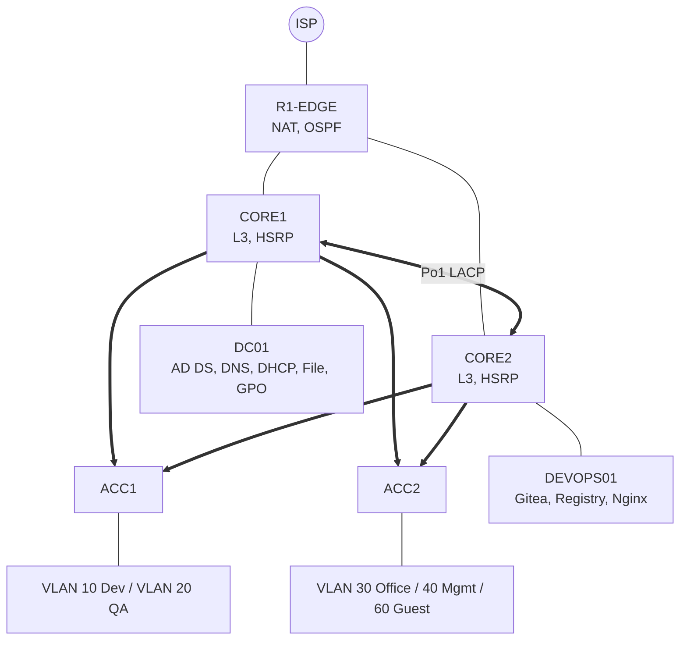

# Đề tài 07: Triển khai hạ tầng mạng doanh nghiệp hỗn hợp Cisco, Windows Server và Linux

> Môn: Xây dựng hạ tầng mạng (XDHTM)

| Thông tin | |
|---|---|
| Sinh viên thực hiện | Trần Ngọc Đăng Khoa |
| Lớp | Xây Dựng Hạ Tầng Mạng |
| Giảng viên hướng dẫn |Hồ Quý Thuận |

## 1. Mục đích

Xây dựng hạ tầng đa nền tảng gồm mạng Cisco, Windows Domain và dịch vụ DevOps trên Linux.

## 2. Tình huống

Công ty có **90 nhân viên** thuộc các nhóm Dev, QA, HR và IT, cần có **Git Server** và **Docker Registry** nội bộ.

## 3. Yêu cầu và cách đáp ứng

| Yêu cầu | Giải pháp |
|---|---|
| VLAN Dev, QA, Office, Management, Server, Guest | VLAN 10, 20, 30, 40, 50, 60 trên switch Cisco 3650 |
| OSPF | OSPF area 0 giữa R1-EDGE, CORE1, CORE2 |
| EtherChannel | LACP giữa hai core và từ access lên core |
| ACL giữa Dev/QA | ACL extended chiều in trên SVI, chặn Dev ↔ QA |
| Windows Server 2022: AD DS, DNS, File Server, GPO | Máy chủ DC01, domain `dt07.lab` |
| Ubuntu Server: Gitea, Docker, Nginx reverse proxy | Máy chủ DEVOPS01 chạy Gitea, Docker Registry, Nginx HTTPS |

Thành phần bổ sung: HSRP (dự phòng gateway), NAT (ra Internet), DHCP, kết nối Gitea với Active Directory qua LDAP.

## 4. Sơ đồ tổng quan



## 5. Quy hoạch VLAN

| VLAN | Tên | Mạng | Gateway | Đối tượng |
|---:|---|---|---|---|
| 10 | DEV | 10.7.10.0/24 | 10.7.10.1 | 40 nhân viên Dev |
| 20 | QA | 10.7.20.0/24 | 10.7.20.1 | 20 nhân viên QA |
| 30 | OFFICE | 10.7.30.0/24 | 10.7.30.1 | 15 nhân viên HR |
| 40 | MANAGEMENT | 10.7.40.0/24 | 10.7.40.1 | 15 nhân viên IT, quản trị thiết bị |
| 50 | SERVER | 10.7.50.0/24 | 10.7.50.1 | DC01 (.10), DEVOPS01 (.20) |
| 60 | GUEST | 10.7.60.0/24 | 10.7.60.1 | Khách, chỉ ra Internet |

## 6. Công cụ sử dụng

| Công cụ | Vai trò |
|---|---|
| Cisco Packet Tracer | Mô phỏng router 2911 và switch 3650 |
| VMware Workstation 17 | Chạy máy ảo Windows Server 2022, Ubuntu Server 24.04, Windows 11 |
| Gitea, Docker, Nginx | Git Server, Docker Registry, reverse proxy HTTPS |

## 7. Cấu trúc thư mục

```text
.
├─ README.md                 Giới thiệu đề tài (file này)
├─ BAO_CAO_HUONG_DAN.md      Hướng dẫn triển khai từng bước kiêm báo cáo
├─ packet-tracer/            File sơ đồ DT07.pkt
├─ configs/
│  ├─ cisco/                 Cấu hình đang chạy của router, switch
│  ├─ windows/               Lệnh PowerShell đã chạy trên DC01
│  └─ linux/                 docker-compose.yml, cấu hình Nginx
└─ docs/
   └─ images/                Ảnh minh chứng
```

Thư mục `Lab/` (file ISO, máy ảo) chỉ nằm trên máy cá nhân, không đưa lên Git.

## 8. Tiến độ

- [x] Phân tích, thiết kế VLAN, IP, ACL
- [x] Dựng sơ đồ và cấu hình Cisco trên Packet Tracer
- [x] Windows Server: AD DS, DNS, DHCP, File Server, GPO
- [x] Ubuntu Server: Docker, Gitea, Docker Registry, Nginx
- [x] Máy trạm gia nhập domain, kết nối Gitea với AD
- [x] Kiểm thử tổng thể và hoàn thiện báo cáo

## 9. Tài liệu

Hướng dẫn chi tiết từng bước, lệnh cấu hình và bảng kiểm thử: [BAO_CAO_HUONG_DAN.md](BAO_CAO_HUONG_DAN.md)
